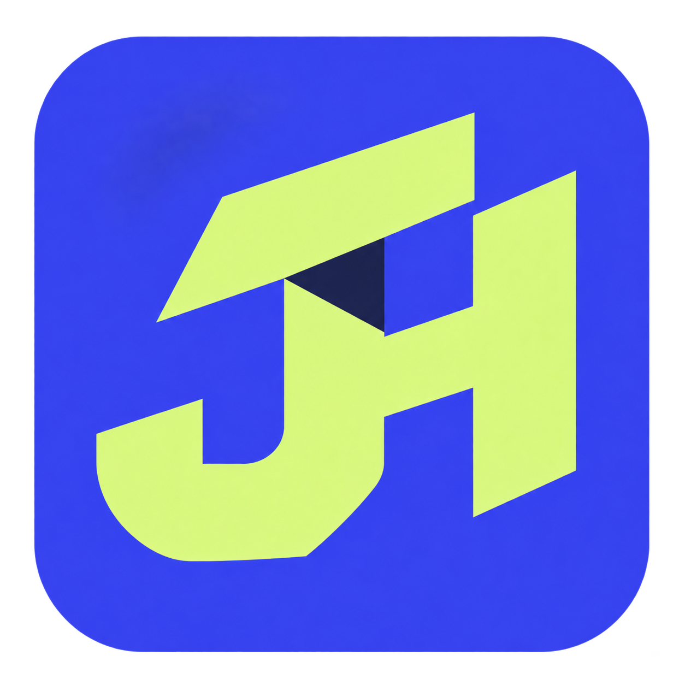
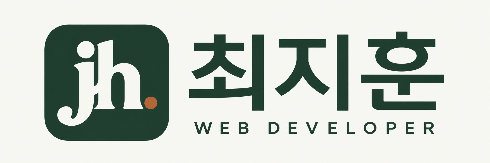
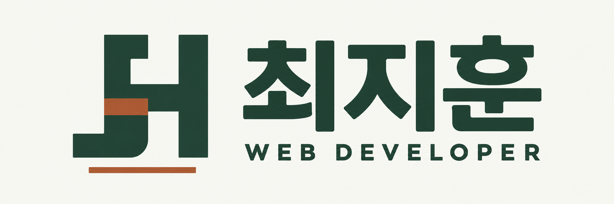
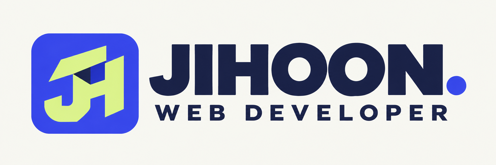
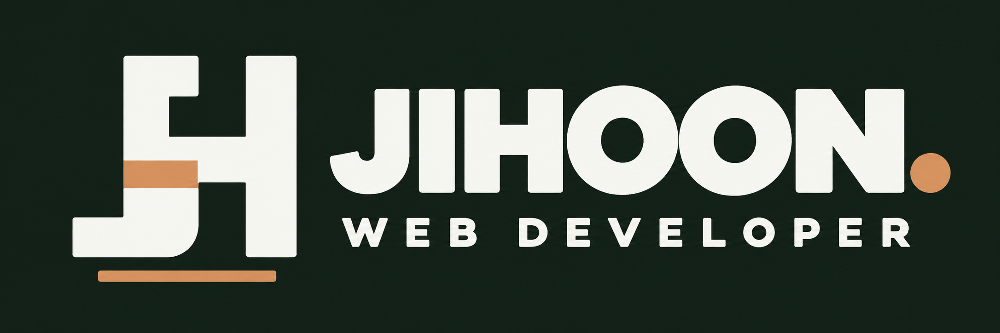

# 포트폴리오 파비콘과 메인 로고 시안

2026-11-12에 만든 비교용 시안입니다. **파비콘 3개·메인 로고 3개, 총 6개**이며 같은 열을 한 세트로 구성했습니다. 기존 두 방향은 현재 딥그린·아이보리·구리색 포인트를 이어가고, C는 더 대담한 색상과 형태를 탐색합니다.

| 구분 | A · 에디토리얼 이니셜 | B · 연결과 구조 | C · 대담한 변주 |
| --- | --- | --- | --- |
| 파비콘 |  |  |  |
| 메인 로고 |  |  |  |
| 의도 | 세리프 `jh.`와 한글 이름으로 기존 인상을 정돈 | 기하학적 J/H와 구리색 연결부로 화면·업무·시스템 연결 표현 | 블루·라임과 접힌 J/H, 영문 이름으로 개인의 인상 강화 |

현재 컨셉에 가장 가까운 쪽은 A, 기본 추천은 **B 세트(F2 + L2)**입니다. B는 현재 색상을 유지하면서 작은 심벌과 이름을 함께 기억하기 쉽고, 포트폴리오가 설명하는 연결의 개념도 담습니다. C는 색상과 인상을 더 적극적으로 바꾸고 싶을 때의 대안입니다.

이 파일들은 선택 전 PNG 컨셉입니다. 최초 생성 단계에서는 큰 이미지의 이름·문구·형태를 확인했고, 이후 아래 로컬 예시에서 16·32px 파비콘 샘플과 반응형 헤더·다크 모드를 확인했습니다. 실제 적용본을 만들 때는 단색 조형과 투명 가장자리를 정리하고 최종 SVG·ICO의 작은 크기를 다시 검수해야 합니다. 메인 로고는 현재 불투명한 아이보리 배경의 비교본이며, 심벌·이름·부제를 분리하면 작은 화면과 다크 모드에 대응하기 쉽습니다.

## 시안별 로컬 예시

**B안 운영 반영 후 비교 서버 3007·3008·3009는 종료했습니다.** 아래 주소는 당시 비교용 실행 기록입니다. 현재 결과는 [운영 사이트](https://nextport-roan.vercel.app/)에서 확인하고, A·C로 바꾸려면 위 브랜드 설정을 사용합니다. 원본 이미지와 실행 사본은 보존합니다.

2026-11-12 기준으로 같은 포트폴리오 화면에 각 시안의 파비콘·메인 로고를 적용한 별도 서버입니다. 상단 비교 막대에서 다른 안으로 이동하거나 16·32px 파비콘과 로고 원본을 확인할 수 있습니다.

| 시안 | 홈 | 전체 프로젝트 |
| --- | --- | --- |
| A · 에디토리얼 이니셜 | [3007](http://127.0.0.1:3007/) | [3007/projects](http://127.0.0.1:3007/projects) |
| B · 연결과 구조 | [3008](http://127.0.0.1:3008/) | [3008/projects](http://127.0.0.1:3008/projects) |
| C · 블루/라임 변주 | [3009](http://127.0.0.1:3009/) | [3009/projects](http://127.0.0.1:3009/projects) |

예시는 저장소 밖 `%LOCALAPPDATA%/nextport/brand-preview-20261112-d3d0be8a`의 분리된 사본에서 실행합니다. 운영 공개 페이지가 반환하는 프로젝트 표시 데이터 7개를 읽으며, Notion 인증값을 로컬에 복사하거나 DB를 수정하지 않습니다. 인증된 Notion API를 직접 조회한 검증과는 구분합니다.

홈·전체 목록의 HTTP 응답, 홈의 1280·360·320px 라이트/다크 표시와 가로 넘침 없음, B 목록의 파주 검색을 확인했습니다. 브라우저 제목에도 A안·B안·C안을 표시합니다. 서버 세 개와 비교 탭은 사용자가 선택할 때까지 유지하며, 선택 이후에는 실행 기록으로 소유자를 확인한 비교용 프로세스만 정리합니다. 원본 PNG 6개는 보존합니다. 현재 실행 기록과 검증 범위는 [현재 상태](../../CURRENT_STATE.md)에 정리했습니다.

최초 비교 이미지 6개는 이 폴더에 그대로 보관합니다. 이후 선택한 B안의 코드 적용과 추가 자산은 아래처럼 구분하며, 기존 `favicon.ico`·Notion·환경변수·배포는 유지합니다. 보안 수정 계획은 사용자 요청에 따라 보류했습니다.

## 선택한 B안 보완

B의 연결형 심벌과 C의 굵은 `JIHOON.` 글자 형태를 조합한 새 로고입니다. 기존 B 한글 로고를 덮지 않고 운영용 자산 폴더에 두 버전을 따로 저장했습니다.

| 라이트 | 다크 |
| --- | --- |
|  |  |
| 딥그린·구리색, 투명 배경 | 아이보리·밝은 구리색, 어두운 배경 |

다크 파일은 투명 출력의 잔여 흔적을 피하기 위해 사이트의 어두운 배경에 맞춘 불투명 PNG로 제작했습니다. C안은 생성 이미지여서 원본 폰트 파일이나 정확한 폰트명은 없습니다. 글자 모양과 굵기를 참고해 재구성한 결과이며 폰트 파일을 그대로 이식했다고 설명하지 않습니다. 사용한 최종 프롬프트·파일 해시는 [선택본 제작 기록](selected-b-prompts.json)에 있습니다.

[브랜드 설정](../../../config/portfolio-brand.js)의 `activeBrand: 'b'`가 기본값입니다. `a`나 `c`로 바꾸면 보존한 로고·파비콘으로 함께 전환하고, B에서는 기존 테마 버튼에 맞춰 두 로고가 자동 전환됩니다. [자세한 전환 방법](../../PREVIEW.md#로고와-파비콘-전환)을 참고하세요. 운영 사이트 변경에는 별도 빌드·배포가 필요합니다.

제작 도구는 **내장 image_gen**, 사용한 최종 프롬프트와 파일 해시는 [prompts.json](prompts.json)에 있습니다. A 파비콘은 배경 투명도 결함이 있던 첫 생성본 대신 불투명한 정사각형으로 다시 생성한 최종 비교본을 보관했습니다. 기존 컨셉 근거는 [현재 헤더](../../../components/portfolio/portfolio-shell.js)와 [색상·모노그램 스타일](../../../styles/portfolio-preview.module.css)입니다.
