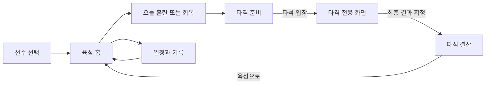

# 타자 육성 화면과 성장 연결 계획

기준일: **2026-11-25 KST**. 목표는 선수를 관리하는 시간과 직접 타격하는 시간을 분리하고, 키운 능력이 타석에서 어떤 효과를 내는지 이해하게 하는 것이다. **단계1 집중 화면·단계2 저장 없는 비교에 이어, 같은 날 후속 사용자 승인으로 단계3 성장 규칙과 단계4 개발 세이브·복구 코드 연결을 로컬 구현했다. 새 선수만 v2 성장 보정을 사용하며 단계5의 실제 기기 조작·수치 체감 검수는 남아 있다.** 실행 결과와 다음 작업 상태는 [현재 상태](../CURRENT_STATE.md#타자-성장-v2와-선수-복구-코드--2026-11-25) 한 곳에서 관리한다. 아래 초기 설계와 현행 구현을 구분하며, 로컬 적용을 운영 배포나 밸런스 검수 완료로 해석하지 않는다.

## 현재 기반과 적용 범위

기존 `/playground/baseball/career`와 영문 경로 안에서 화면을 전환한다. 달리기와 같은 몰입형 Shell은 이미 헤더 아래를 채우고 푸터를 숨긴다. 이를 재사용해 같은3031에서 개발하며 새 프레임워크나 별도 게임 서버를 도입하지 않는다.

| 초기 기반 | 현행 처리 |
| --- | --- |
| 3경기, 경기당2타석, 가상1·4·7일 | 첫 구현에서도 같은6타석을 유지한다. 실제 리그 일정·9이닝·팀 승패와 구분한다. |
| 선수 이름·등번호·10팀·좌우타와 같은 브라우저 세이브 | 처음에는 같은 브라우저 복구만 제공했다. 후속 승인으로 선수 단위 복구 코드를 추가했으며, 코드로 다른 브라우저에서 같은 선수를 이어간다. 새 로그인은 추가하지 않는다. |
| 파워·선구·체력 훈련과 휴식 | 기존 v1은 선택과 보상을 유지한다. 새 v2에 미트 훈련+2를 추가하며 기존 훈련·휴식 비용과 타석/경기 보상은 유지한다. |
| 직접 타격에는 성장 보정 없음 | v1은 그대로다. 새 v2만 타석 시작 때 확정한 미트·파워 스냅샷을 직접 타격에 적용한다. |
| 자동 입력에는 선구·파워·컨디션 일부 반영 | v2 자동 타격도 같은 성장 커널을 사용한다. 파워에 따른 좌우 조준 오차 축소는 제거하고 초기 기준으로 고정해 파워 보정과 중첩하지 않는다. 선구·컨디션의 기존 입력 정책은 유지한다. |
| 승인된 실사풍 자세·10팀 의상·공8cm·110ms 기준·4구종 | 원본과 기존 조작을 유지한다. 새로운 관리 화면을 만들며 타격폼을 다시 제작하지 않는다. |
| 저장된 성장 원장·입력·서버 확정 결과 | 화면 이동으로 새 공·타석·보상·입장곡을 만들지 않는다. |

## 화면 흐름

‘타격 준비’로 이동하는 것은 화면 이동이다. 실제 새 타석은 준비 화면의 **타석 입장**에서만 기존 명령을1회 보낸다. 이미 진행 중인 타석이 있으면 **이 타석 이어하기**를 보여 주고 기존 타석을 재사용한다. 볼·스트라이크·파울은 같은 타격 화면 안에서 이어지며 최종 타석 결과가 확정돼야 결산할 수 있다.

| 화면 | 기본 정보 | 주요 행동과 전환 |
| --- | --- | --- |
| 선수 선택 | 저장 선수, 팀·등번호·손, 진행 상태 | 새 선수 만들기 또는 이어하기. 대기 요청/충돌을 먼저 알린다. |
| 육성 홈 | 선수, 현재 경기/상대, 이번 경기 타석 수, 컨디션·XP, 준비 여부 | 오늘의 준비, 타격 준비, 일정·기록 확인 |
| 오늘의 준비 | 훈련 카드, 실제 능력 증분·XP·컨디션 비용 | 카드 선택은 미리보기이고 ‘준비 완료’1회로 확정한다. 이미 준비한 경기는 재선택하지 않는다. |
| 타격 준비 | 선수, 현재 경기·타석, 설정한 구속/구종 조건, 저장 상태 | 신규 타석 입장 또는 진행 중 타석 이어하기. 다음 공의 숨은 코스는 공개하지 않는다. |
| 타격 전용 | 경기장, 볼카운트, 필요한 선수 정보, 조작·다음 공·설정·중단 | 관리 메뉴를 접고 타격에 집중한다. 입력 후 확인 대기는 기존 요청을 확인한다. |
| 타석 결산 | 확정 결과, 타석 성적, 이번에 발생한 성장 사건과 현재 컨디션 | 연출과 결과를 확인한 뒤 ‘육성으로’. 다음 타석도 사용자 선택으로 시작한다. |
| 경기/시즌 결산 | 경기당2타석 결과, 합산 성적, 실제 원장의 성장 변화 |3경기 완료 여부와 기록을 보여 준다. 장기 시즌·은퇴 결과를 만들지 않는다. |

## PC와 모바일 배치

PC 육성 홈은 작은 메뉴, 팀·등번호 중심의 선수 영역, 오늘 할 일/주요 능력 패널로 구성한다. 첫 구현에서는 경기장용 선수 이미지를 중복 합성하지 않고 팀 색과 등번호 카드를 사용한다. 인물 초상은 필요할 때 별도 검토한다. 전체 원장과 출처별 통계는 ‘기록’에서 열고 현재 선택한 본문만 스크롤한다. 모든 패널을 한 화면에 다시 늘어놓지 않는다.

모바일 육성은 **육성·일정·기록·선수**4개 탭을 사용한다. ‘육성’ 안에서 오늘 훈련을 고르고 결과를 확인하며, 핵심 행동은 화면 아래 가까운 위치에 둔다. 작은 화면에서 키보드가 열려도 선수 이름/등번호 오류와 제출 버튼에 접근할 수 있어야 한다.

타격 화면은 두 기기 모두 **작은 헤더 → 필수 HUD → 경기장 → 현재 행동 버튼** 순서로 공간을 배분한다. 육성 탭과 긴 설명·원장·개발 JSON을 숨긴다. 연결 실패·충돌·확정 대기는 간결한 상태 표시와 상세 열기로 제공하며 정상 상태처럼 감추지 않는다. 원래 경기장 비율과 공/배트 세계좌표·터치 역변환을 유지하고 작은 가로 화면의 중첩 스크롤과 고정 최소높이를 정리한다.

라이트·다크와 한영은 기존 공통 설정을 따른다. 실사풍 경기장과 딥그린/금빛 HUD를 유지하고, OS 모션 축소에서도 화면 이동과 상태를 읽을 수 있게 한다. 브라우저 전체화면 버튼은 별도 선택 기능으로 남기며 기본 몰입형 배치의 필수 조건으로 삼지 않는다.

## 화면 전환과 진행 상태 보존

- 커리어 저장 클라이언트와 공유 음향 소유권은 상위에서 유지한다. 같은 타석의 자식 컴포넌트와 저장 어댑터를 탭마다 재발급하지 않는다.
- 타격 화면을 숨길 때는 기존 중단 절차로 공·입력·음향·입장/결과 표시를 정리한다. 숨긴 Canvas의 포커스·새 입력과 불필요한 그리기도 중단한다. 다시 보여 줘도 자동 투구하지 않는다.
- 스윙 입력 전 중단은 기존 같은 공 준비로, 입력이 이미 보관/접수된 중단은 **입력한 결과 확인**으로 돌아간다. 결과를 확인하기 전에 다시 스윙하게 하지 않는다.
- 신규 타석 요청 중 육성으로 돌아가면 표시 의도를 취소한다. 늦은 서버 응답은 저장 상태에 반영하되 사용자의 화면을 강제로 다시 열거나 입장곡을 재생하지 않는다.
- 타석 완료는 처음 마운트한 스냅샷이 아닌 현재 타석ID의 최신 확정 영수증과 커리어 체크포인트로 판단한다. 영수증이 왔다고 홈런 효과를 끊고 바로 육성으로 이동하지 않는다.
- 결산은 같은 타격면의 결과 영역에 표시하고 현재 타석·연출 소유자를 유지한다. 타격→결산 전환 자체로 타석을 언마운트해 홈런 효과를 끊지 않으며, 사용자의 명시적 육성 복귀는 즉시 허용한다.
- 저장 실패는 같은 요청을 재전송한다. 충돌에서는 기존 입력/대기 요청을 보존하고 최신 서버 기록을 확인한 뒤 명시적으로 채택한다. 화면 선택만으로 서버 기록을 덮지 않는다.
- 반복 키·터치 손 떼기·중복 클릭·한글 조합 중 Enter가 준비/타석 입장/결산을 여러 번 확정하지 않게 한다. 관리 창과 숨겨진 타격장은 게임 입력을 받지 않는다.

## 성장 능력과 첫 보정 후보

초기 비교 후보를 바탕으로 로컬 구현한 새 v2의 기본 능력은 **미트·파워·선구·체력**이며 초기값은 각각40이다. 컨디션은 소모/회복 상태, XP와 코치 신뢰는 누적 진행 지표다. XP 자체가 배트나 타이밍을 추가 강화하지 않으며 같은 보너스를 중복 합산하지 않는다. 아래 수치는 현재 v2 적용 기준이며 실제 기기에서 성장 수준별 타격감을 검수한 최종 밸런스라는 뜻은 아니다.

| 능력 | 현행 연결과 후속 | 유지할 경계 |
| --- | --- | --- |
| 미트 | 육성 전용 접촉 보조 범위를 확대 | 실제 배트 길이·공 크기·110ms 기준·0~210ms 유효 구간을 유지 |
| 파워 | 같은 접촉 품질의 타구 속도를 최대5% 보정 | 각도/코스/타이밍을 자동 수정하지 않으며 기존190km/h 상한 유지 |
| 선구 | 기존 자동 볼 판단·상하 조준·타이밍 입력 정책을 유지. 개인별 코칭 강화는 후속 | 숨은 목표 코스·완성된 미래 궤적이나 실제 없는 약점을 임의 표시하지 않음 |
| 체력 | 기존 훈련·컨디션 소모를 유지. 소모 완화 보정은 후속 | 새로운 직접 타격 피로 벌점을 함께 넣지 않음 |

미트·파워의 v2 진행률은 `u(a) = clamp((a - 40) / 60, 0, 1)`이다.40 이하는 기본 배율을 유지하고, 손상/누락 능력치를40으로 조용히 대체하지 않는다. 추가 밸런스 조정은 이미 시작한 타석·기존 세이브에 소급하지 않도록 버전 보존 정책과 함께 별도로 검토한다.

| 능력치 | 접촉 허용 거리 배율 | 공 중심과 배트 선분의 허용 거리 | 파워 타구 속도 배율 |
| --- | --- | --- | --- |
|40 |1.00 |7.300cm |1.000 |
|70 |1.06 |7.738cm |1.025 |
|100 |1.12 |8.176cm |1.050 |

기본 접촉 거리는 배트 반경3.3cm와 공 반경4cm의 합7.3cm다. v2는 이 허용 거리에 `1 + 0.12 × u(mit)`를 적용하며 배트 전체 길이64cm를1.12배로 늘리는 뜻이 아니다. 원래 배트 표시 아래에 **접촉으로 인정하는 공 중심 범위**를 초록 투명 가이드로 보여 준다. 실제 배트 크기와 구분하며 모바일 확대 여부와 관계없이 같은 세계좌표를 사용한다.

기본 범위 밖에서 보정 덕분에만 접촉한 공은 자동 정타로 만들지 않는다. v2의 보조 접촉 품질 상한은0.55이며 기존 시간/배트 각도에 따른 파울 방향은 유지한다. 이 제한은 새 보조 접촉에만 적용하며 타구 속도·발사각을 계산하기 전에 품질을 확정한다. 접촉 여유와 품질 계산의 기준 반경을 분리해 반경 확대만으로 수직 품질·발사각이 함께 달라지는 일을 막는다. 기본 범위 안의 스위트스폿 확장은 적용하지 않았으며 후속 비교 대상으로 남긴다.

v2 파워는 기존 품질로 계산한 타구 속도에 `1 + 0.05 × u(power)`를 적용하고40~190km/h로 제한한다. 변경한 속도로 비행·착지·수비 판정의 파생값 전체를 같은 규칙으로 계산한다. 실제 담장 통과·수비 결과가 확정돼야 홈런/안타이며 비거리 숫자나 능력치만으로 결과를 바꾸지 않는다. 강해진 타구도 수비 처리에 따라 아웃으로 바뀔 수 있다.

v2 자동 진행도 타석 시작 때 고정한 같은 성장 스냅샷으로 물리/수비를 계산한다. 별도 v2 자동 정책에서 ‘파워가 좌우 조준 오차를 줄이는 효과’를 제거하고 좌우 오차를 초기40 기준으로 고정했다. 파워는 타구 속도에만 적용하며 선구·컨디션의 기존 입력 정책은 유지한다. 새 능력치를 결과 추첨 확률로 바꾸거나 재전송 때 다시 추첨하지 않는다. v1 자동 진행의 원래 정책은 변경하지 않는다.

## 훈련과 결산에서 보이는 성장

v1의 기존 훈련3종+휴식은 그대로다. 새 v2는 **미트·파워·선구·체력 훈련+휴식**5개 선택을 제공한다. 매 경기 준비1회, 훈련은 해당 능력+2·XP+2·컨디션−6, 휴식+15이며 기존 타석/경기/목표 보상은 유지한다. 체력의 소모 완화 수식과 선구의 추가 보조는 구현하지 않았고 후속 체감 검수 뒤 별도 검토한다.

훈련 선택 카드에는 현재→상한 반영 예상값과 비용을 표시한다. 후속 보완에서 **서버가 새 준비 원장 사건1건을 확정한 경우의 실제 전후 강조·1회 성장 애니메이션**까지 구현했다.0증분은 그대로 표시하고 모션 축소는 정적 대체이며 실패/읽기/재시도/복구·늦은 응답에는 가짜/반복 연출을 만들지 않는다. 실제 확인 범위는 [최신 상태](../CURRENT_STATE.md#훈련-ui복구-안내와-대기-기록-진단--2026-11-25)를 따른다. 결산은 원장의 실제 증분을 읽으며 상한 때문에 오르지 않은 값·목표 미달성·중복 영수증에 보상을 만들어 표시하지 않는다. 경기 전 훈련과 방금 타석에서 받은 성장을 구분한다.

현재3경기에서 미트에 훈련을 모두 투자해도40→46이며 v2 식의 허용 거리는 **1.2%·약0.876mm** 증가한다. 파워에 모두 투자하면 타구 속도 보정은 **0.5%**다. 따라서3경기는 흐름·저장 검수로 유지하며 개발 비교의40/70/100으로 성장 차이를 따로 확인한다. 검수용 능력치를 실제 선수 세이브나 실제 성장 속도로 복사하지 않는다.144경기·다년 육성으로 확장할 때 성장 속도와 경기 기회 수를 함께 조정한다.

## 저장 계약과 구버전 선수

성장 보정은 새 v2 선수에게만 적용한다. 기존 v1의 도메인·검증기·API·저장 경로는 보존하고 v2를 별도 계약으로 연결했다. 기존 선수의 능력/원장에 미트를 일괄 채우거나 과거 타석을 새 산식으로 다시 계산하지 않는다. DB 행을 남기는 것만으로 보존을 완료했다고 표시하지 않으며 실제 조회·이어하기 검수 범위는 현재 상태에 기록한다.

적용한 보존 정책은 **완료한 기존 선수는 그대로 조회, 진행 중 기존 선수는 기존 규칙으로 끝까지 이어하기, 새 성장 규칙은 신규 선수로 시작**이다. 선수의 버전에 따라 클라이언트·저널·검증기와 타석 버전값을 분리한다. 알려지지 않은 버전은 원본/대기를 보존한 오류로 처리하고 새 규칙에 자동 편입하지 않는다.

서버는 타석 입장 시 저장된 능력치와 적용 정책에서 해당 타석의 보정 스냅샷을 확정한다. 스냅샷에는 정책 버전, 선수·기준revision·경기·타석, 미트/파워와 계산된 접촉 허용 거리·파워 배율·보조 접촉 품질 상한을 고정한다. v2 타석의 상위 값과 상태 내부 값, 부모 커리어의 진행 타석 값은 일치해야 한다. 클라이언트가 제출한 임의 능력치를 믿지 않으며 원 입력과 확정 결과를 함께 검증한다. 타석 도중 훈련·복구·다른 탭의 변경으로 적용값을 바꾸지 않는다. 완료한 타석에도 당시 스냅샷을 보관한다.

부모 커리어의 타석/성적/성장 사건과 자식 타석은 기존처럼 원자적으로 확정한다. 신규 미트와 그 증분을 원장 검증에 포함하고 같은 명령의 재전송에는 기존 영수증을 반환한다. 오래된 버전의 미처리 명령과 충돌 원장을 보존하고 새 규칙의 명령과 섞지 않는다.

현재 Next Pages Router·서버 API·드라이버·제한 역할을 유지한다. v2 저장과 선수 복구 코드의 개발 DB 연결·마이그레이션 이력은 현재 상태에서 관리한다. 원본과 분리한 시험 브랜치에서 마이그레이션을 검수하는 원칙은 후속 변경에도 유지한다. [Neon 브랜치 안내](https://neon.com/docs/introduction/branching)

운영 DB·Notion 콘텐츠·100m 보드/쿠키/Cron·기존10구와 단독 타석의 원본은 이 계획의 변경 대상이 아니다. 실서비스 연결값·토큰·내부 관리ID를 계획서/공개 로그에 추가하지 않는다. 같은 브라우저 복구만 제공하던 초기 범위는 **2026-11-25 후속 사용자 승인으로 선수 단위 복구 코드까지** 확대했다. 새 로그인이나 자동 동기화를 추가한 것은 아니다.

- 복구 코드의 발급·조회·교체·폐기는 선수를 처음 만든 **원래 익명 소유자**만 할 수 있다. 코드를 사용한 다른 브라우저에는 해당 선수를 이어갈 권한만 부여하며 소유권이나 코드 관리 권한을 넘기지 않는다.
- 코드로 다른 브라우저에서 같은 선수·규칙·확정 기록을 이어간다. 이미 그 브라우저에 있던 다른 선수와 대기 요청을 덮지 않는다. 코드 교체·폐기는 이전 코드와 그 코드로 받은 브라우저 권한을 무효화하며 원래 소유자와 선수 기록은 유지한다.
- 원래 익명 소유 쿠키는30일이며 복구 코드는 자동 만료가 없다. 원래 쿠키가 만료되거나 삭제된 뒤 코드로 선수를 불러와도 원 소유자의 코드 관리 권한까지 복구되지는 않는다. 코드를 아는 사람이 선수를 조작할 수 있으므로 비공개로 보관하고, 화면을 벗어나면 표시한 코드 값은 지운다. 원문 코드를 일반 기록·문서·공개 로그에 남기지 않는다.

## 구현 단계와 완료 기준

| 단계 | 작업 | 완료 기준 |
| --- | --- | --- |
|1 화면 분리 — 로컬 구현 | 기존 성장 규칙으로 선수 선택·육성·준비·타격·결산을 분리 | 화면 이동만으로 새 명령/보상 없음, 같은 타석/대기 요청 보존, 숨긴 화면 입력 차단, 결산 연출 유지. 실제 휴대폰 검수는 후속 |
|2 성장 비교 — 로컬 구현 | 저장 없는 개발 비교에서40/70/100·미트/파워를 각각 비교 | 동일 투구/입력 대조, 새 실제 선수/성적/보상 없음, 보정 범위와 가이드 일치. 후보 체감·실제 휴대폰 검수는 후속 |
|3 성장 규칙 — 로컬 구현 | 새 v2의 미트·파워 공통 커널과 별도 자동 입력 정책 적용 | 기본40의 기존 판정 동등성, 신규 외곽 품질0.55·정타 차단, 타구/수비 재계산, 자동 파워 중복 효과 제거 |
|4 세이브·복구 연결 — 로컬 구현 | v1 원본 경로와 v2 계약 분리, 개발 DB 저장, 서버 시작 스냅샷, 선수 단위 복구 코드 | 능력 변조/누락 거절, 중복 보상 없음, 중단/재시도/복구 시 같은 적용값. 원 소유자만 코드 관리, 교체·폐기 시 이전 연결 권한 무효화. 세부 실행 검수 범위는 현재 상태 참조 |
|5 수치 체감·실기기 검수 — 후속 | PC·모바일 직접 조작, 성장 수준별 접촉·정타·파울·안타·장타 분포 비교 | 데이터와 사용자 체감으로 추가 조정 여부 결정. 실제S22/iPhone 조작·청취·다른 브라우저 복구를 자동 테스트·화면 크기 비교와 구분 |

단계1은 API/SQL·성장 산식을 바꾸지 않고 먼저 구현했고 단계2도 저장 없는 비교로 분리했다. 이후 후속 승인에 따라 단계3·4를 새 v2와 개발 저장 경로로 연결했다. 단계2의 비교값을 실제 선수에게 임의로 복사하지 않으며 기존 v1에 새 규칙을 소급하지 않는다. 단계5의 실제 기기 체감은 아직 남아 있고 고정 경계 격자 분석이나 자동 테스트를 사용자 성공률·실제 성장 측정으로 대신하지 않는다.144경기·다년 육성은 별도 후속이다.

## 검수 시나리오

- **진행:** 선수 생성/이어하기→훈련 선택/확정→신규 타석 또는 이어하기→볼/스트라이크/파울→최종 결과→육성 복귀→다음 타석/경기. 완주하지 않은 타석을 결산하거나 자동으로 다음 공을 시작하지 않는다.
- **입력:** 클릭·터치·키보드·한글 IME, 반복 Enter/Space·중복 클릭·터치 손 떼기, 숨긴 타격면·메뉴·앱 전환/잠금, 입장 요청 뒤 화면 복귀와 늦은 응답을 확인한다.
- **화면:** PC1280×720/1920×1080/QHD, 모바일320×568/390×844/412×915·844×390/932×430, 한영·라이트/다크·모션 축소에서 가로 넘침과 주요 행동 접근을 확인한다. 실제S22 Ultra Chrome/카카오톡·iPhone Safari 확인은 별도로 기록한다.
- **기하와 시간:**4구종·좌우투·좌우타·구속 조건에서 기준/접촉 경계 안팎/배트 끝·정타 중심/0ms·110ms·210ms 및 유효 시간 밖을 비교한다. 미트 보정이 시간 밖 헛스윙을 접촉으로 바꾸지 않아야 한다.
- **성장과 수비:** 미트/파워를 각각 고정해 다른 효과가 섞이지 않게 비교한다. 기본40의 결과 동등성, 보조 접촉의 품질 제한, 파워 상한·착지/수비 재계산, 자동 입력의 중복 강화 여부를 확인한다. 성장했다고 모든 타구가 안타가 돼야 한다는 문턱은 사용하지 않는다.
- **저장:** 구버전 완료/진행 선수 조회·이어하기, 새 버전 능력 누락/변조, 중단·새로고침·두 탭 충돌·네트워크 실패·같은 명령 재전송, 상한의 실제 원장 증분과 중복 지급 방지를 확인한다. 복구 코드는 원 소유자의 발급/조회/교체/폐기, 다른 브라우저의 해당 선수 이어하기, 관리 권한 제한, 이전 코드·연결 권한 무효화와 기존 타석 스냅샷 유지를 구분해 확인한다.

원래16자세·유니폼·타격감과10구/단독 타석은 보존한다. 기존 두 단계 가속의 실제 게임 연결, 수비 표시·세리머니·구장 생동감은 [별도 연출 계획](BASEBALL_ARCADE_PRESENTATION_PLAN.md)의 후속이며 이 화면 개편에 묶어 완료로 처리하지 않는다. 커밋·푸시·공개·배포는 기존 보류 상태를 유지한다.
