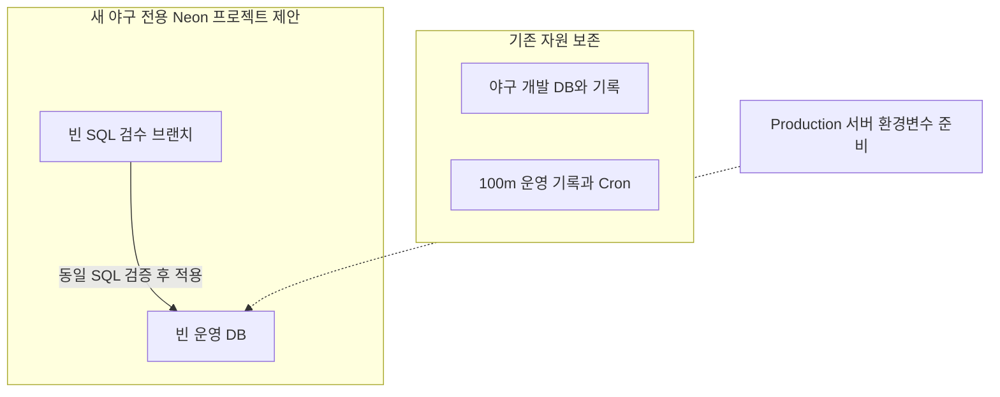

# 야구 운영 저장공간·권한·환경변수 준비 계획

기준일 **2026-11-26 KST**. 대상은 **오늘부터 타자 / Batter Journey**다. 개발 DB 분리·선수 세이브·성장 v2·복구 코드 결정을 소스와 SQL에 대조한 작업계획이다. 승인 후 [A단계 운영 기반 준비](../CURRENT_STATE.md#야구-운영-저장-기반-준비--2026-11-26)와 [B단계 보호된 Preview 검수](../CURRENT_STATE.md#야구-운영형-preview-검수--2026-11-26)를 진행했다. 재개 시 현재 상태와 저장소 밖 비공개 관리 자료에서 기존 자원과 남은 검사를 확인한다.

## 1. 목표와 완료 범위

**권장안은 기존 개발·100m 자원을 유지하고, 새 야구 전용 Neon 프로젝트의 빈 운영 DB에 제한 권한과 서버 환경변수를 준비하는 것이다.** 개발 기록은 그대로 남기고 운영은 새 기록으로 시작한다. 기존 개발 DB를 운영으로 이름만 바꾸거나 데이터를 복사하는 전환은 하지 않는다.

| 단계 | 완료의 의미 | 이 계획의 범위 |
| --- | --- | --- |
| A. 운영 기반 준비 | 빈 운영 DB·객체 소유 역할·제한 앱 역할·SQL·독립 비밀값·Production 범위 환경변수 준비 및 권한 검증 | 후속 승인으로 구현. 결과는 현재 상태 기준 |
| B. 운영형 검수 | 환경별 UI/API 허용 정책 구현, 별도 Preview 저장소 연결, 실제 HTTPS에서 저장·이어하기·코드 복구 검증 | Preview 배포 및 HTTPS 검증 완료. 실기기 확인은 공개 전 |
| C. 사용자 공개 | 공개 기준을 충족한 육성을 실제 Production에서 활성화하고 운영 검증 | B 이후 별도 실행 범위 |

**A를 완료해도 공개 사이트는 계속 ‘준비 중’이고 야구 저장 API는 차단되어 있어야 한다.** 저장공간을 준비하는 승인과 육성/수집 기능을 모두 공개하는 승인을 같은 것으로 취급하지 않는다.

## 2. 계획 작성 당시의 확인 상태

- 시작 Git은 `master / 33c6179`, 작업 트리는 clean이었다. Node22.23.1/npm10.9.8·직접 의존성14개의 설치/lock 일치를 확인했다. 이 계획 때문에 런타임·드라이버·의존성을 변경하지 않는다.
- 최근 공개 배포는 완료되었지만 육성은 준비 안내다. 현재 [육성 페이지](../../pages/playground/baseball/career.js)는 development에서만 실제 게임을 불러온다. [공통 DB 설정](../../lib/server/baseball-db.mjs)은 development·활성값·전용 DB/역할을 함께 검사하므로 Production에 환경변수만 넣어도 저장이 열리지 않는다. Preview 역시 현행 production 빌드 조건에서는 차단된다.
- 기존 개발 DB 관리 메타데이터를 기준으로 Neon 프로젝트/개발 브랜치 존재와 PostgreSQL18·카탈로그를 읽기 조회했다. 실제 선수·투구·복구 코드 원문 행은 조회하지 않았다. 기존 DB의 새로 만든 복제나 쓰기는 없다.
- Vercel 환경변수는 복호화 없이 메타데이터만 확인했다. 현재 기존6개에 `BASEBALL_` 변수는 없다. 실제 값·연결 문자열·프로젝트/브랜치/엔드포인트 ID는 이 문서에 기록하지 않는다.
- 기존 [개발 저장 계약](../PREVIEW.md#개발용-저장복구와-neon)과 [선수 세이브·복구 계약](../PREVIEW.md#야구-선수-세이브와-3경기-육성)은 유지한다. 10구 수집, 단독 한 타석, 육성v1/v2는 서로 다른 저장 계약이다.

## 3. 저장공간 선택

| 선택지 | 장점과 영향 | 판단 |
| --- | --- | --- |
| 기존 개발 브랜치 안에 DB만 추가 | 자원 추가가 작지만 같은 compute·역할 관리 범위를 공유한다. 잘못된 권한/SQL 대상 선택의 영향을 줄이기 어렵다. | 이번 기본안으로 사용하지 않는다. |
| 기존 프로젝트에 별도 운영 브랜치 | 데이터 변경은 분리할 수 있으나 생성 시 부모 데이터·역할/비밀번호가 복사될 수 있다. 기존100m/개발 데이터가 있는 부모를 잘못 선택하지 않아야 한다. | 자원 한도 등 제약이 있을 때 다시 비교할 대안이다. |
| **새 야구 전용 프로젝트 + 빈 운영 DB** | 기존 프로젝트·개발 기록·100m와 관리/compute 경계를 나누고, 신규 운영을 빈 데이터로 시작할 수 있다. 생성 가능 수·사용량·복원 정책 확인이 필요하다. | **우선 권장안** |

이는 프로젝트 범위를 줄이기 위한 nextport의 설계 판단이다. Neon의 일반 브랜치는 부모의 데이터/스키마뿐 아니라 역할·비밀번호도 물려받을 수 있으므로 ‘새 브랜치 생성’만으로 빈 데이터·독립 자격증명을 보장하지 않는다. [Neon 브랜치 기준](https://neon.com/docs/manage/branches)

다음 이름은 **생성 전 논리 예시**다. 실제 자원 ID·호스트·관리 URL은 저장소 밖 비공개 관리 자료에 보관한다.

| 구분 | 권장 구성 | 데이터·접근 |
| --- | --- | --- |
| 기존 개발 | 기존 프로젝트/브랜치·`baseball_dev`·`baseball_runtime` 그대로 | 개발 데이터·쿠키 식별·저널·비밀값 보존 |
| 신규 운영 | 새 프로젝트의 운영 브랜치, `baseball_prod` | 빈 상태로 시작. 실제 사용자 데이터는 C 이후 생성 |
| 운영 SQL 검수 | 신규 프로젝트의 **아직 업무 데이터가 없는 시점**에서 만든 임시 검수 브랜치 | 동일한 운영용 SQL을 적용할 빈 `baseball_prod`. 실제 운영과 독립 비밀번호·비밀값 |
| 향후 Vercel Preview | 별도 검수 DB/역할/비밀값과 명시적인 Preview 범위 | Production 연결값을 전달하지 않음. 이번 A에서 상시 Preview 배포까지 만들지는 않음 |

### 생성 전 확인

1. 같은 Neon 계정/조직에서 새 프로젝트·검수 브랜치를 만들 수 있는지, 현재 사용량/한도·과금 영향을 확인한다. 유료 전환이 필요하면 해당 조건을 구체화한 뒤 진행하며 자동으로 플랜을 변경하지 않는다.
2. 새 DB는 개발과 같은 PostgreSQL18을 기준으로 한다. 새 메이저 업그레이드를 섞지 않는다. 리전은 기존 Vercel 함수 실행 리전과의 거리를 확인해 정하며, 기존100m/개발 리전은 옮기지 않는다.
3. 운영 브랜치 자동 만료는 없어야 한다. 검수 브랜치의 만료/정리는 새로 만든 시험 자원만 대상으로 기록한다. 유료 기능인 브랜치 보호를 필수로 가정하지 않는다.
4. 새 프로젝트의 기본 빈 DB 외에 야구 전용 DB를 명시적으로 만들고, 기존 프로젝트/브랜치를 부모로 사용하지 않는다. 임시 검수 브랜치는 **운영 업무 행과 운영 runtime 자격증명을 만들기 전**에 분기해 불필요한 복사를 막는다. 복사된 기본 관리 자격증명은 앱에 전달하지 않는다.
5. 복원 가능 기간과 실제 백업 수단을 확인한다. 브랜치가 있다는 사실을 영구 백업으로 설명하지 않는다. 운영 공개 전에는 별도 비공개 백업/복원 방법과 보관 비용도 확인한다. [Neon 프로젝트·복원 설정](https://neon.com/docs/manage/projects)

## 4. DB 역할과 권한

| 역할 | 허용 | 금지·경계 |
| --- | --- | --- |
| 관리/마이그레이션 실행자 | 새 전용 DB 생성, 제한 역할 생성, 승인 SQL 적용, 카탈로그 검증 | Vercel 앱 연결에 사용하지 않음. 기존 개발/100m 대상으로 실행하지 않음 |
| 객체 소유 역할 예: `baseball_prod_owner` | NOLOGIN. 야구 스키마·테이블·함수 소유, 필요한 함수 내부 작업 | 비관리 역할. 앱 runtime이 이 역할의 member이거나 SET ROLE할 수 없어야 함 |
| 앱 역할 예: `baseball_prod_runtime` | LOGIN, 대상 DB CONNECT, `baseball_private` USAGE, 허용한 RPC EXECUTE | 테이블/시퀀스 직접 접근, CREATE/TEMP, DB/역할 생성, BYPASSRLS, 관리자/owner membership 금지 |

제한 앱 역할은 **SQL로 생성**하고 `NOSUPERUSER NOCREATEDB NOCREATEROLE NOBYPASSRLS NOINHERIT` 및 membership을 검사한다. Neon Console/API의 기본 관리자 역할을 앱 역할로 사용하지 않는다. Neon은 생성 경로에 따라 관리자 membership이 달라지므로 역할 이름만 보고 제한 역할이라고 판단하지 않는다. [Neon 역할과 SQL 생성 기준](https://neon.com/docs/manage/roles)

- 신규 owner의 소유권 설정/관리자의 SET ROLE 가능 여부를 실제 Neon 권한으로 먼저 검증한다. 지원되지 않으면 관리자 권한을 runtime에 추가해 통과시키지 않고 객체 소유 방식부터 수정한다.
- 신규 프로젝트의 기본 빈 `neondb`도 PUBLIC CONNECT/TEMP 권한을 검사한다. 운영 bootstrap은 그 DB가 존재하면 실행자의 소유 권한을 먼저 확인한 뒤 PUBLIC/owner/runtime 권한을 회수한다. 기존 프로젝트나 다른 DB의 권한을 일괄 회수하지 않는다.
- 현행 소스의 야구 객체는 **17개 테이블·24개 함수**이며, 앱에 허용된 RPC는 **17개**, 나머지 내부 helper는 **7개**다. 운영 SQL 준비 시 실제 signature/의존성을 다시 대조한다. 숫자 일치만으로 권한 검증을 대신하지 않는다.
- 테이블·시퀀스·함수의 PUBLIC/runtime 자동 권한을 회수하고, **실제로 객체를 만드는 owner를 지정한** 기본 권한을 설정한다. `GRANT EXECUTE ON ALL FUNCTIONS`로 내부 helper까지 열지 않는다.
- `SECURITY DEFINER` 함수는 비관리 owner 소유·신뢰 가능한 스키마만 탐색하도록 한다. 운영용 함수의 `search_path`는 `pg_catalog, baseball_private, pg_temp`처럼 임시 스키마가 마지막이 되도록 검토한다. 생성·REVOKE·개별 GRANT를 같은 트랜잭션에 넣어 PUBLIC에 열리는 틈을 만들지 않는다. [PostgreSQL18 함수 권한 기준](https://www.postgresql.org/docs/18/sql-createfunction.html#SQL-CREATEFUNCTION-SECURITY)
- 현재 경계는 서버의 소유자/입력 검증과 제한 RPC다. RLS 기반 사용자 인증이 이미 구현됐다고 설명하지 않는다. Neon Auth·새 로그인·브라우저 직접 DB 연결은 추가하지 않는다.

## 5. 운영용 SQL 준비와 적용 순서

기존 개발 SQL5개는 **그대로 보존**한다. 각 파일이 `current_database() = 'baseball_dev'`와 개발 runtime을 검사하므로 운영 DB에 그대로 실행하는 절차로 쓰지 않는다. 첫 SQL은 DB/PUBLIC·public 스키마 권한도 회수하므로 기존100m DB에 적용해서는 안 된다.

| 순서 | 개발 원본 | 운영용으로 준비할 내용 |
| --- | --- | --- |
| 0 | 새 준비 절차 | 빈 전용 DB·owner/runtime 및 실행 대상/권한 사전 검사 |
| 1 | [기본 수집 SQL](../../db/playground-baseball.sql) | 10구 수집3테이블·2개 공개 RPC와 기본 권한 |
| 2 | [한 타석 SQL](../../db/migrations/20261124-baseball-at-bat-sessions.sql) | 세션·투구·명령3테이블,3개 공개 RPC |
| 3 | [육성v1 SQL](../../db/migrations/20261124-baseball-career.sql) | 기존v1 구조4테이블,4개 공개 RPC |
| 4 | [성장v2 SQL](../../db/migrations/20261125-baseball-career-v2.sql) | v1과 분리된v2 구조4테이블,4개 공개 RPC |
| 5 | [복구 코드 SQL](../../db/migrations/20261125-baseball-career-recovery.sql) | 코드/접근권한/요청 제한3테이블,4개 공개 RPC. v1/v2 이후 적용 |

후속 승인으로 `db/production/`에 [000 bootstrap](../../db/production/000-baseball-production-bootstrap.sql), [001 기본 수집](../../db/production/001-baseball-production.sql), [002 한 타석](../../db/production/002-baseball-at-bat-sessions.sql), [003 육성v1](../../db/production/003-baseball-career.sql), [004 성장v2](../../db/production/004-baseball-career-v2.sql), [005 복구 코드](../../db/production/005-baseball-career-recovery.sql)를 준비했다. 객체 정의·판정·저장 트랜잭션은 기존 계약을 유지하고 아래 차이만 명시적으로 검토한다.

1. 개발 DB guard를 삭제하는 대신 **예상 운영 DB·owner/runtime·적용 순서**를 정확히 검사한다. 다른 DB/관리자 앱 역할이면 실패해야 한다.
2. 소유권을 실행자에게 암묵적으로 맡기지 않고 owner 역할로 통일한다. 기존 SQL의 개발 역할 대상 GRANT/REVOKE와 기본 권한을 운영 역할 기준으로 정리한다.
3. 동일한 운영용 파일을 빈 검수 브랜치에 먼저 적용한다. 검수와 운영의 DB/역할 이름은 같게 둘 수 있으나 엔드포인트·실제 자격증명은 서로 다르다. 운영 비밀값을 검수 브랜치에 넣지 않는다.
4. 각 단계는 트랜잭션으로 적용하고 파일 체크섬·적용 순서·catalog 검증 결과를 비공개로 기록한다. `IF NOT EXISTS`만으로 기존 구조가 맞다고 단정하지 않는다.
5. 컬럼·제약·인덱스·소유권·함수 signature·ACL·search_path가 기대한 구조와 맞으면 같은 파일을 빈 운영 DB에 적용한다. 개발/100m를 대상으로 한 `DROP`·삭제·재계산·원본 이관은 없다.
6. 기존 `@neondatabase/serverless`와 Next API를 유지한다. 마이그레이션은 관리용 직접 연결로, 향후 앱은 제한 runtime의 서버용 연결로 분리한다. 관리 접속값을 Vercel 앱 환경변수로 저장하지 않는다.

초기 운영이 비어 있어도 v1 구조를 유지하는 것은 복구 RPC의 의존성과 버전 호환 계약 때문이다. 개발v1 데이터를 운영으로 이관한다는 뜻은 아니다. 신규 선수를v2로 만드는 기존 정책도 바꾸지 않는다.

## 6. 환경변수와 비밀값

### 준비할 값

| 이름 | Development | 임시 SQL 검수/향후 Preview | Production 준비값 | 저장 형태 |
| --- | --- | --- | --- | --- |
| `BASEBALL_DATA_ENABLED` | 기존 설정 유지 | 앱 미연결/OFF. 향후 Preview 정책 구현 때 별도 판단 | **`false`** | 비밀 아닌 Config |
| `BASEBALL_DATABASE_URL` | 기존 개발값 유지 | 검수 자원 전용 runtime 연결. 운영값 복사 금지 | 새 운영 DB의 runtime 연결 | 서버 전용 Secret |
| `BASEBALL_SIGNING_SECRET` | 기존 개발값 유지 | 검수 자원 전용 독립 비밀 | 새 운영 전용 독립 비밀 | 서버 전용 Secret |

임시 SQL 검수 연결을 지금 Vercel Preview에 등록할 필요는 없다. Production 준비값은 기존 Vercel 프로젝트의 **Production 대상에만** 저장하고, 기존6변수·팀 공통값·기존 연동은 건드리지 않는다. 자동 연동이 일반 `DATABASE_URL`이나100m용 변수를 덮는 방식도 사용하지 않는다.

Vercel은 환경별 값을 구분하며 환경변수 변경은 새 배포부터 적용된다. **값 저장이 끝났다는 사실과 실행 중 배포에 적용됐다는 사실을 따로 기록한다.** 이번 A에서 재배포를 하지 않는다면 적용 상태는 ‘다음 배포용 준비’다. 이후 승인된 배포에서도 현재 가드는 유지한다. [Vercel 환경별 적용 기준](https://vercel.com/docs/environment-variables)

URL과 비밀은 플랫폼의 Secret 형태로 저장하고 메타데이터의 key/target/type만 검증한다. 값 원문은 공개 로그·커맨드 인자·캡처·Git·SSG props·브라우저 번들·`NEXT_PUBLIC_`에 넣지 않는다. 운영값을 `env pull`로 로컬 `.env`에 내려받지 않는다. 저장 후 다시 읽을 수 없는 형태라면 검증을 위해 무의미하게 교체하지 않고 승인된 비밀관리/복구 수단을 사용한다. [Vercel Config/Secret 기준](https://vercel.com/docs/environment-variables/sensitive-environment-variables)

### 키를 계속 유지해야 하는 이유

현행 [익명 소유권](../../lib/server/baseball-auth.mjs)과 [복구 코드 암호화](../../lib/server/baseball-career-recovery.mjs)는 같은 `BASEBALL_SIGNING_SECRET`으로 다음 값을 만든다.

- 익명쿠키 서명과 DB의 소유자 식별 HMAC
- 복구 코드 조회 HMAC
- 목적을 구분한 HKDF/AES-256-GCM 암호화 키

새 운영 비밀은 암호학적 난수32바이트 이상으로 독립 생성한다. 개발·100m·Cron 비밀을 재사용하지 않는다. **운영 기록이 생긴 뒤 임의로 새 값을 넣으면 기존 쿠키·소유권 연결·코드 조회/복호화가 함께 끊길 수 있다.** 현재는 키 버전 전환/keyring이 없으므로 정상적인 코드 배포 때 값을 재생성하지 않는다. 비밀은 승인된 비밀관리 위치에서 안정적으로 보관하고, 회전이 필요하면 이전 키 호환/데이터 이행을 별도로 설계한다. DB 역할의 접속 비밀번호 교체와 이 애플리케이션 비밀의 교체도 같은 작업으로 취급하지 않는다.

## 7. 실제 작업 순서와 산출물

| 단계 | 작업 | 완료 근거 |
| --- | --- | --- |
| A0 기준본 | Git/버전·개발 메타데이터·원본 보존·기존6환경변수 target을 확인 | 실제 비밀/사용자 원문을 제외한 비공개 기준본 |
| A1 SQL 준비 | 개발5파일을 보존한 운영용 SQL과 대상/권한/순서 검증 준비 | 파일 diff·정적 의존성·기존 RPC 계약 대조 |
| A2 신규 자원 | 한도/리전/PG18 확인 후 새 프로젝트·빈 검수 브랜치·DB 준비 | 기존 자원과 다른 ID/호스트임을 비공개 대조, 기존 자원 변경0 |
| A3 검수 적용 | SQL로 제한 역할·owner 생성, 동일 운영용 SQL을 검수 브랜치에 적용 | 구조·ACL·금지 권한·RPC 계약 검증 통과 |
| A4 운영 적용 | 검수 통과 파일과 독립 비밀번호를 새 운영 DB에 적용 | 동일 파일 체크섬, 업무 테이블 빈 상태, 개발/100m 쓰기0 |
| A5 비밀·환경 | 운영 비밀 생성/보관, Production에3변수만 준비 | Secret/Config·target 정확, 기능OFF·기존6변수 메타데이터 동일 |
| A6 인계 | 연결/권한·보존·미활성 상태를 정리 | 현재 상태 갱신. 실제 배포/공개 여부는 별도 표시 |

A0~A6은 후속 승인 범위에서 수행하며 실제 결과는 현재 상태를 기준으로 한다. 계획 문구만으로 작업 완료를 판단하지 않는다. 새 패키지·전역 CLI 설치·플랜 변경·Notion/100m 자원 변경은 포함하지 않는다. 기존 연결 도구가 충분하면 재인증이나 새 계정을 요구하지 않는다.

## 8. 완료 검사

### A의 필수 검사

- **분리:** 새 자원/연결이 기존 개발·100m와 다르고 개발 데이터/쿠키/저널/복구 코드가 자동 복사·전환되지 않았는지 확인한다. 신규 운영 업무 테이블은 빈 상태여야 한다.
- **권한:** 제한 runtime으로 연결 가능하지만 직접 테이블 읽기/쓰기·DDL·TEMP·owner SET ROLE은 거절되어야 한다. 승인 RPC만 허용되고 내부 helper 직접 호출은 거절되어야 한다. 실제 카탈로그 권한과 오류를 함께 확인한다.
- **SQL 계약:** 검수 브랜치에서 잘못된 owner/revision·명령 충돌은 거절되고 같은 명령 재시도는 보상/행을 중복 생성하지 않는지 확인한다. 타석+선수+명령 원장의 원자 저장과 v1/v2·성장 스냅샷을 대조한다. 서버 재계산은 기존 코드/계약 변경0을 정적·관련 모의 검사로 확인한다. 실제 HTTPS→API 재계산→DB 저장의 전체 연결은 B에서 검증한다.
- **검수 데이터:** 합성 승부/검수용 식별자만 사용하고 실제 사용자 원문을 복제하지 않는다. 권한 위반·쓰기 시험은 새 검수 브랜치에서 수행한다. 운영 확인은 카탈로그/빈 데이터/제한 역할 연결 위주로 하며 운영에 임의 선수를 등록해 시험하지 않는다.
- **환경:** 기존6변수와 로컬 개발 설정을 유지하면서 Production에 야구3변수만 정확한 형태로 준비했는지 확인한다. 개발·검수·운영의 실제 자격증명을 비교할 때 값은 출력하지 않는다.
- **차단 보존:** 현재 UI 준비 안내와 API의 설정 불가 응답을 유지한다. 환경 저장만으로 다른 야구 API나 개발 진단 패널을 열지 않는다. 기존 Notion 목록·100m 공개 랭킹은 읽기 비교한다.
- **공개 자료:** 소스/문서/Git diff·향후 빌드/공개 응답에서 실제 키·관리ID·연결값·복구 코드 원문이 없는지 검사한다. DB 접속 성공·자동 테스트·실제 브라우저 검수를 서로 다른 근거로 기록한다.

SQL 변경에 맞는 격리 DB/권한 테스트를 수행하며 제품·규칙을 바꾸지 않은 준비 단계에 1,001개 게임 테스트를 새 성공 횟수처럼 반복 집계하지 않는다. 후속 코드/기능 활성화에서는 관련 API·버전·클라이언트 회귀와 lint·빌드를 다시 수행한다. 로컬 검증에는 운영 비밀을 복사하지 않고 새 검수 자원이나 모의 설정을 사용한다.

### A 이후 공개 전 검사

1. 현행 development 조건을 대체할 **명시적인 환경·기능별 허용 정책**을 설계한다. `NODE_ENV=development`로 운영을 속이지 않는다. 커리어 가드를 풀면서10구 수집·단독 타석까지 의도 없이 함께 여는 변경도 피한다. 빌드 시 UI와 실행 시 API가 같은 허용 정책을 사용해야 한다.
2. 독립된 Preview 연결/비밀로 실제 HTTPS 쿠키·같은 origin 요청·생성/훈련/타석/저장/새로고침·다른 브라우저 코드 복구·코드 교체/폐기 후 접근 해제를 검수한다. Preview가 Production DB에 접근하지 않는 것도 확인한다.
3. 원쿠키30일과 복구 코드 무기한·원소유자만 코드 관리라는 기존 한계를 유지한다. 쿠키 만료를 선수 데이터 삭제 기한으로 해석하지 않는다. DB 원본/입력의 보관 기간·선수 삭제/접근 상실 정책은 공개 전에 확정하며 현재 미구현인 삭제 기능을 있다고 안내하지 않는다.
4. 최신 육성의 실제 휴대폰·복사·동시 접근·저속망/장시간 검수와 성장 체감은 기존 타격 모바일 정상 답변으로 대체하지 않는다. 요청 한도·장기 저장량 점검도 운영 검수 범위로 남긴다.
5. 공개 조건이 충족된 뒤 실제 Production 활성화/배포·최초 저장을 검증한다. 헤더·카드의 ‘준비 중’ 문구와 저장 가용성이 함께 맞아야 한다.

## 9. 실패와 복구

| 발생 시점 | 대응 | 보존 |
| --- | --- | --- |
| 신규 생성/검수 실패 | 중단하고 새 자원의 대상·권한부터 수정한다. 자동으로 기존 개발/100m를 대안 DB로 사용하지 않는다. | 기존 자원·기록·설정 전부 |
| 운영 SQL 중간 실패 | 해당 트랜잭션을 롤백하고 적용 완료 단계와 실제 catalog를 확인한다. 기능은 계속OFF다. | 앞선 정상 단계와 원본 SQL |
| 환경변수 오류 | 새 야구 변수의 target/연결을 수정하고 활성화는 보류한다. owner 연결로 우회하지 않는다. | 기존6변수·개발 설정·생성된 DB |
| 향후 공개 뒤 앱 장애 | 신규 쓰기를 차단하고 호환되는 앱으로 복귀한다. 환경 변경은 새 배포 적용 여부까지 확인한다. | 선수·타석·명령 원장·복구 grant·비밀값 |

기존 데이터가 생긴 뒤 DB 삭제·개발 사본 덮기·과거 브랜치로 되돌리기는 일반 앱 롤백으로 사용하지 않는다. 과거 버전이 새 세이브를 읽지 못하면 원본과 대기 명령을 보존한 채 안내/차단하고, v2를v1으로 다시 계산하지 않는다. 임시 검수 자원 정리도 생성/대상·유지 요청을 확인한 뒤 새 시험 자원만 대상으로 한다.

## 10. 이번에 보존할 결정과 다음 착수 기준

- 기존 개발v1/v2·10구·D/E 원본과 미확정 `result_mismatch` 대기1건을 보존한다. 그 기록을 운영에 강제로 올리거나 허용 오차를 넓혀 정상 처리하지 않는다.
- Notion·100m DB/역할·쿠키·서명·v1/v2 보드·IP 정리 Cron은 재사용하거나 바꾸지 않는다. 야구 IP 수집·공개 랭킹·새 Cron도 추가하지 않는다.
- 새운영은 신규 시작이므로 개발 선수/복구 코드가 운영에서 곧바로 통한다고 안내하지 않는다. 이관이 필요하면 별도 요구와 호환·소유권 검증 계획을 만든다.
- 계획 작성 단계는 이 계획과 현재 상태 문서만 작성했다. 후속A 구현의 SQL/테스트/설명 변경은 현재 상태에서 구분한다. 현재3031 서버·브라우저 탭·기존 환경/설치와 원격 배포는 그대로 둔다. 실제 ID/호스트·키·접속값·카탈로그 원문은 공개 문서에 추가하지 않는다.

다음 작업은 보호된 Preview에서 실제 휴대폰의 조작·복구 코드 복사를 확인하고, 데이터 보관·삭제 절차와 요청 한도를 검토하는 것이다. 이 결과를 바탕으로 C단계의 공개 범위를 확정한다.
