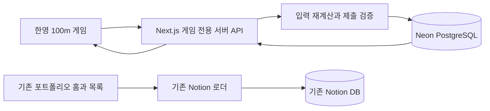

# 100m 달리기 TOP10 DB 서비스 비교와 연결 계획

기준일: **2026-11-17**. 상태: **설계 제안**. DB 연결·계정 생성·코드 구현·커밋·배포는 이번 범위에 포함하지 않습니다.

후속 사용자 요청에서 Neon 연결을 선택했습니다. 이 문서는 비교 당시 계획으로 보존하며 실제 개발 DB 연결·구현·검증 결과는 [현재 상태](../CURRENT_STATE.md)의 후속 기록을 따릅니다.

**Neon PostgreSQL 무료 플랜으로 시작하고, 기존 Next.js의 서버 API를 통해 기록을 검증·등록하는 구성을 추천합니다.** 프로젝트 소개는 기존 Notion에서 계속 읽으며, 게임 기록은 별도 DB에서 관리합니다. 서비스·순위 정책은 아래 제안을 확인한 뒤 확정합니다.

이 문서의 ‘현재’·‘미구현’은 **설계 당시**를 뜻합니다. 이후 Neon 연결·서버 완주 검증·v2 순위표·IP 정리 이력이 구현됐으므로 새 작업은 [100m 재개 절차](../PREVIEW.md#100m-달리기-작업-재개)와 [최신 상태](../CURRENT_STATE.md#100m-달리기-마감과-재개-기준)를 먼저 읽습니다. 아래 제안·단계는 설계 근거로 보존하며 실제 설치·운영 상태로 해석하지 않습니다.

## 1 현재 구현과 연결 범위

현재 게임은 이름·국적·그림체 설정, 사이드뷰 경기, 한영 화면, 탑뷰 리플레이와 기록 등록 미리보기를 제공합니다. 기록·개인 최고·리플레이는 React 메모리에만 있으며 DB 드라이버·순위 API·로그인 기능은 없습니다.

| 현재 코드 | 연결 시 사용할 부분 |
| --- | --- |
| `lib/playground-sprint.mjs` | 서버에서도 같은 규칙으로 교대 발 입력을 실행하고 완주 시간을 계산 |
| `lib/playground-sprint-replay.mjs` | 입력 순서·좌우 교대·완주 정합성 검사의 참고 구현 |
| `lib/playground-sprint-player.mjs` | 이름 NFC 정규화·공백 정리·16 code point 제한과 국가 코드 검증 재사용 |
| `lib/playground-sprint-record.mjs` | 미리보기 데이터와 공식 등록 데이터를 구분하고 규칙 버전 연결 |
| `components/playground/sprint-record-preview.js` | TOP10 등록 자격·공개 항목 확인·저장 중/성공/실패 화면으로 확장 |
| `pages/api/` | 게임 전용 API 추가. 기존 Pages Router 유지 |

현재 리플레이는 ±1ms 정합성 검사 후 클라이언트의 완주 시간을 다시 클립에 넣습니다. 따라서 `clip.finishTimeMs`를 공식 점수로 그대로 저장하지 않고 **엔진이 재계산한 시간을 반환하는 서버 검증 함수**를 분리합니다. 현재 `finishedAtISO`도 브라우저 시각이므로 공식 등록 날짜로 신뢰하지 않습니다.

## 2 서비스 비교

무료 한도는 조회일의 공식 가격표 기준이며, 가입 방식·서비스 정책이 바뀔 수 있어 실제 연결 전에 다시 확인합니다. 아래 적합도는 요구사항에 대한 설계 판단입니다.

| 서비스 | 무료 플랜 핵심 | 이번 게임에 유리한 점 | 고려할 점 | 판단 |
| --- | --- | --- | --- | --- |
| **Neon PostgreSQL** | 프로젝트당 월 **100 CU-hours**, 저장소 **1GB**, 전송 **5GB** | SQL 정렬·제약·트랜잭션 사용. 5분 비활성 뒤 compute가 내려가도 다음 요청에 자동 시작 | 첫 요청의 기동 지연 가능. 상시 polling으로 깨어 있으면 무료 compute 소모 | **1순위** |
| **Supabase PostgreSQL** | DB **500MB**, 전송 **5GB**, 활성 무료 프로젝트 **2개** | 표 편집·SQL Editor·DB 함수/RPC, 이후 인증·관리 기능 확장에 편리 | 7일간 DB 활동이 부족하면 프로젝트가 정지될 수 있고 Dashboard에서 Resume 필요 | **관리 기능을 우선하면 대안** |
| **Firebase Firestore** | 저장소 **1GiB**, 하루 읽기 **50,000회**, 쓰기·삭제 각각 **20,000회** | 관리형 문서 DB와 트랜잭션. Firebase 사용 경험이 있으면 접근하기 쉬움 | 읽기·쓰기 횟수 기반 관리, 순위와 동시 갱신을 문서 구조에 맞춰 설계해야 함 | **Firebase를 이미 쓸 때 대안** |

무료 한도 출처: [Neon 요금제](https://neon.com/docs/introduction/plans), [Supabase 가격표](https://supabase.com/pricing), [Firestore 가격](https://firebase.google.com/docs/firestore/pricing). 비활성 동작: [Neon Scale to Zero](https://neon.com/docs/introduction/scale-to-zero), [Supabase Free 프로젝트 정지](https://supabase.com/docs/guides/platform/free-project-pausing).

Neon은 **DB만 추가하면 되는 현재 범위**와 저활성 포트폴리오의 운영 방식에 잘 맞습니다. 월 100 CU-hours는 접속 100시간이나 무조건 한 달 무료를 뜻하지 않습니다. 예를 들어 0.25 CU를 계속 쓰면 산술상 400시간에 해당하므로, 매초 순위를 가져오거나 서비스를 깨워 두는 작업은 넣지 않습니다. 실제 지연·트래픽별 비용은 연결 후 측정합니다.

Supabase는 나중에 로그인·관리 화면을 함께 키우려면 편리합니다. 이번 게임만을 위해 유료 상시 운영을 선택할 경우 현재 Pro는 월 **US$25부터**입니다. [가격표](https://supabase.com/pricing)

Firestore도 TOP10 배열을 한 문서에 넣고 트랜잭션으로 갱신할 수 있습니다. 다만 이 프로젝트에서는 이미 서버 API와 SQL로 처리하기 좋은 작은 고정 스키마가 있으므로 PostgreSQL을 우선합니다. [Firestore 트랜잭션](https://firebase.google.com/docs/firestore/manage-data/transactions)

### Notion을 기록 DB로 쓰지 않는 이유

기존 Notion은 프로젝트 소개를 편집하는 원본으로 유지합니다. 방문자 제출은 빈도 제한·중복 방지·동시 TOP10 판정을 처리해야 하므로 별도 트랜잭션 DB가 적합합니다. 현재 Notion API는 일반 플랜 기준 연결당 분당 180회이며 데이터 소스 조회에 별도 제한도 적용합니다. 게임 제출을 기존 소개 조회 연결에 섞지 않습니다. [Notion 요청 제한](https://developers.notion.com/reference/request-limits)

## 3 추천 연결 구조

브라우저는 같은 사이트의 `/api/playground/sprint/*`만 호출합니다. DB 연결 문자열과 서명 비밀은 서버에만 둡니다. Pages API는 서버 전용이므로 App Router로 이전하거나 별도 상시 서버·WebSocket을 추가할 필요가 없습니다. [Next.js API Routes](https://nextjs.org/docs/pages/building-your-application/routing/api-routes)

한영 페이지는 같은 순위표를 읽으며 번역된 국적명·날짜 표시는 화면에서 처리합니다. 실사풍/도트와 탑뷰/사이드뷰는 같은 경기 규칙이므로 순위를 나누지 않습니다. 기록 DB 장애가 포트폴리오의 Notion 조회를 막지 않도록 의존성과 오류 처리를 분리합니다.

## 4 공개 기록과 순위 정책 제안

| 항목 | 권장 정책 |
| --- | --- |
| 공개 항목 | 순위·이름 또는 닉네임·완주 기록·선택한 국적·등록일시 |
| 날짜 의미 | **DB가 생성한 UTC 등록일시**. 화면에서 이용자 지역 시간으로 표시하고 브라우저가 주장한 완주 시각과 구분 |
| 기록 단위 | 현 화면과 같은 **0.01초** 단위 정수 `time_cs`. 예: 9.55초는 955 |
| 동점 | 표시 단위가 같으면 DB에서 먼저 확정한 기록 우선. 잠금 획득 뒤 발급하는 등록 순번으로 순서를 고정하고 1~10번 자리를 부여 |
| 규칙 구분 | `game_key`와 `rule_version`으로 구분. 가속·감속·최소 입력 간격 등 경기 규칙 변경 시 새 순위표 |
| 참가 방식 | 로그인 없는 손님 모드. 서버가 발급한 1차 도메인 HttpOnly 익명 쿠키로 **이 브라우저의 최고 1개** 관리 |
| 이름 중복 | 허용. 이름·국적을 사람의 고유키나 계정으로 취급하지 않음 |
| 저장 대상 | 등록 시점에 TOP10에 들어가는 검증된 기록만. 10개 미만이면 유효 기록 등록 가능 |
| 탈락 기록 | 새 기록 때문에 10위 밖으로 밀리면 공개 기록 테이블에서 제거. 전체 참가 이력·명예의 전당은 후속 기능 |
| 개인 기록 | 기존의 이번 방문 최고와 온라인 순위를 별개로 표시. TOP10 밖의 과거 개인 기록 보관은 이번 범위에서 하지 않음 |

0.01초 동점 정책을 추천하는 이유는 방문자에게 보이는 기록과 순위 기준을 일치시키기 위해서입니다. 서버 재계산값의 반올림·화면 형식화는 공통 함수로 통일하고 경계값 테스트를 추가합니다. 더 세밀한 경쟁이 필요해지면 0.001초 표시와 순위를 함께 도입합니다.

익명 쿠키는 DB 연결 단계에서 새로 도입할 제안이며 현재 생성하지 않습니다. 쿠키 삭제·다른 브라우저·다른 기기에서는 다른 참가자로 보일 수 있으므로 **1인 1기록 보장**으로 설명하지 않습니다. 공용 기기에서 여러 사람이 참여하려면 별도 참가 방식이 필요합니다. 이후 계정 단위 기록이 필요하면 인증 기능을 추가합니다.

## 5 저장 구조 제안

| 테이블 | 주요 필드와 용도 | 공개 범위 |
| --- | --- | --- |
| `sprint_boards` | `id`, `game_key`, `rule_version`, 활성 여부. 순위표별 잠금 기준 행 | API에는 허용한 게임·규칙명만 제공 |
| `sprint_records` | `id`, `board_id`, `attempt_id`, `participant_hash`, `player_name`, `country_code`, `time_cs`, `recorded_at`, `registration_seq` | 이름·국적·기록·등록일시와 계산된 순위만 |
| `sprint_attempts` | 서버 시작/만료 시각, 시도 상태, 규칙 버전, 참가자 연결, 검증 점수, 제출 내용 해시·처리 결과 | 전체 비공개 |

`attempt_id`는 제출 중복을 막고, `(board_id, participant_hash)`는 같은 브라우저의 중복 자리를 막습니다. 닉네임에 UNIQUE를 걸지 않습니다. 날짜·등록 순번은 순위표 잠금 뒤 DB에서 생성하고 국가 코드는 서버의 허용 목록으로 검증합니다. 더 빠른 기록으로 갱신하면 날짜와 순번도 **새 점수의 등록 시점**으로 바꾸며 같은 점수는 기존 것을 유지합니다. 순위 조회 인덱스는 `(board_id, time_cs, registration_seq, id)`를 기준으로 합니다.

공개 기록은 순위표당 최대 10개로 유지하되, 중복 방지용 시도·짧은 빈도 제한 상태는 별도 행입니다. 따라서 **DB 전체에 10행만 존재한다는 뜻은 아닙니다**. 시도와 제출 결과는 초기안으로 만료 후 24시간까지 보관해 재시도·오류 확인에 사용하고 정리합니다. 전체 키 입력 원문은 서버에서 검증한 뒤 기본적으로 보관하지 않습니다. 이름·국적을 포함한 실패 요청 전문, 쿠키, 토큰과 원본 IP를 로그에 남기지 않습니다.

공개 기록의 `attempt_id`는 감사용 식별자로 남기되 만료되는 시도 행에 FK로 종속시키지 않습니다. 시도 정리가 공개 TOP10을 삭제하지 않도록 `ON DELETE CASCADE`를 사용하지 않으며, 만료된 시도를 정리한 후에는 해당 토큰의 재사용도 거절합니다.

## 6 경기와 등록 흐름

1. **온라인 경기 준비:** 출발 버튼에서 서버에 시도를 요청합니다. 서버가 규칙 버전·만료 시각·무작위 시도 ID를 발급하고 해당 브라우저에 묶습니다. 응답을 받은 뒤 기존 카운트다운을 시작합니다.
2. **게임 진행:** 기존 엔진으로 로컬 입력을 처리하며 유효한 교대 발과 출발 이후 시각을 기록합니다. 입력마다 DB를 호출하지 않습니다.
3. **완주 검증:** 서버가 입력 이력을 같은 규칙으로 다시 실행해 점수를 계산합니다. 브라우저의 점수·순위·국적 추정·날짜와 `isDemo`를 그대로 신뢰하지 않습니다. 이 시점의 TOP10 진입 가능성은 잠정 결과로 표시합니다.
4. **등록 내용 확인:** 진입 가능한 경우 이름·국적을 확인합니다. 현재 등록 미리보기를 확장해 공개 항목과 날짜 의미를 안내합니다. 서버에서 검증한 점수는 편집할 수 없습니다.
5. **원자적 등록:** DB 트랜잭션에서 최신 순위를 다시 확인하고, 여전히 진입 가능하면 같은 브라우저의 더 좋은 기록으로 갱신하거나 삽입합니다. 순위 밖의 기록을 정리하고 시도를 소비합니다.
6. **결과 표시:** 성공한 트랜잭션 이후 확정 순위를 반환합니다. 확인 화면을 보는 사이 경쟁 기록이 등록되어 진입하지 못했다면 현재 기록은 그대로 보여 주고 온라인 미등록 사유를 안내합니다.

| API 제안 | 역할 |
| --- | --- |
| `POST /api/playground/sprint/attempts` | 익명 참가자와 경기 시도 발급 |
| `POST /api/playground/sprint/finish` | 입력 재계산·검증된 점수와 잠정 등록 자격 반환 |
| `POST /api/playground/sprint/records` | 시도 ID·이름·국적만 받아 저장된 검증 점수로 한 번 등록 |
| `GET /api/playground/sprint/leaderboard` | 공개 필드만 포함한 TOP10과 갱신 시각 반환 |

공개 GET은 30~60초 수준의 짧은 캐시를 검토하고, 게임 입장·완주·새로고침 버튼에서 필요한 때만 호출합니다. 공개 GET은 참가자 쿠키를 발급하지 않습니다. 쓰기 응답은 캐시하지 않으며, 저장 성공 직후에는 서버가 반환한 최신 순위를 표시합니다. 캐시된 10위 기록으로 최종 자격을 결정하지 않습니다.

## 7 검증과 동시 제출 처리

### 서버 검증

입력 본문 크기·이벤트 개수·경기 길이·시도 만료를 제한하고, NaN/Infinity·음수/역전 시각·잘못된 발·부당한 반복·규칙 불일치·완주하지 않은 기록을 거절합니다. 같은 시각의 좌우 입력은 현 규칙이 허용하므로 이를 새로 금지하려면 규칙 버전도 변경합니다. 원래 발급한 시각과 완료 요청의 서버 경과 시간을 비교해 극단적인 제출을 걸러도, 네트워크 시간을 달리기 기록에 더하지 않습니다.

자동 시연·리플레이는 온라인 경기 시도를 발급하지 않고 기존 로컬 용도로 유지합니다. 서버가 검증된 시도 없이 기록을 받지 않는 구조로 만들되, 사용자가 요청을 직접 조합하거나 유효한 입력을 합성하는 봇까지 완전히 막을 수는 없습니다. 이 설계는 **허위 점수의 단순 제출·재전송·빈도 남용을 줄이는 취미 게임용 방어**입니다.

발급·완주·등록 요청에 공유 저장 상태를 이용한 빈도 제한을 적용합니다. 서버리스 프로세스의 메모리 카운터만으로는 처리하지 않습니다. 익명 참가자별 제한에 더해 필요한 경우 IP 기반 단기 제한을 검토하며 IP는 참가자 신원으로 사용하지 않습니다. 요청 원본·JSON·Origin을 확인해 브라우저의 불필요한 교차 사이트 제출을 줄이되 CORS를 인증이나 봇 방지로 취급하지 않습니다.

### 트랜잭션

DB 함수 한 번의 실행 안에서 **순위표 기준 행 잠금 → 시도/중복 확인 → 현재 자격 판정 → 더 빠른 기록만 저장 → 초과 기록 정리 → 처리 결과 확정**을 수행합니다. 비어 있는 순위표에서도 같은 기준 행을 잠가 동시 등록을 직렬화합니다. [PostgreSQL 잠금](https://www.postgresql.org/docs/current/explicit-locking.html)

Neon HTTP 드라이버는 비대화형 트랜잭션을 지원하므로 중간 조회 결과에 따른 분기는 SQL 함수 안에 둡니다. 여러 독립 HTTP 호출 사이에 잠금이 유지된다고 가정하지 않습니다. 실행 권한은 게임 전용 함수/데이터로 제한하고 런타임에 DB 소유자 계정을 쓰지 않는 구성을 우선합니다. [Neon 서버리스 드라이버](https://neon.com/docs/serverless/serverless-driver)

같은 시도의 같은 제출을 재전송하면 새 행을 만들지 않고 이전 결과를 반환합니다. 같은 시도로 내용을 바꿔 재등록하면 거절합니다. 저장과 시도 소비가 함께 롤백되도록 하고, 응답 유실 뒤 재시도도 안전하게 처리합니다. 느린 기록은 기존 기록을 덮지 않으며 같은 점수는 먼저 등록한 기록을 유지합니다.

첫 정상 `finish`의 점수와 입력 해시도 시도에 고정합니다. 같은 완주 요청은 같은 검증 결과를 반환하고 다른 입력으로 바꾼 재검증은 거절합니다. 등록 API는 브라우저가 보낸 점수를 다시 받지 않습니다. 최종 TOP10 탈락도 확정된 결과로 시도를 소비해 같은 요청의 재시도에서 결과가 임의로 바뀌지 않게 합니다.

## 8 설정과 운영 경계

| 설정 | 보관 위치와 범위 |
| --- | --- |
| `PLAYGROUND_DATABASE_URL` | 게임 전용 최소 권한 DB 연결 문자열. 서버 환경변수만 |
| `PLAYGROUND_SIGNING_SECRET` | 익명 참가자·시도 토큰 보호용 별도 서버 비밀 |
| `PLAYGROUND_LEADERBOARD_ENABLED` | 순위 읽기/등록 활성화 여부. 꺼도 로컬 경기·리플레이 유지 |
| 기존 Notion 환경변수 | 이름·값·읽기 권한·데이터 원본을 그대로 유지 |

위 이름은 제안이며 실제 값은 문서·Git·공개 로그·`NEXT_PUBLIC_`에 넣지 않습니다. DB 드라이버를 React 컴포넌트에서 import하거나 DB URL을 페이지 props로 전달하지 않습니다. 개발·Preview·Production의 DB/역할을 분리해 로컬 검증이 운영 순위에 기록을 남기지 않게 합니다. 로컬 환경변수는 기존처럼 기본적으로 비워 두고, 승인 후 필요한 별도 개발 DB 설정만 준비합니다.

Neon 직접 가입과 Vercel Marketplace 연결은 청구 주체가 다르므로 실제 연결 전에 선택합니다. 위 무료 수치는 **Neon 직접 요금제** 기준이며 Marketplace에도 같은 조건이 적용된다고 가정하지 않습니다. [Vercel 연결 방식](https://neon.com/docs/guides/vercel-overview)

무료 플랜은 소규모 출발점이며 무료 사용을 보장하는 예산 예측은 아닙니다. Neon의 compute·전송 무료 한도를 소진하면 사용이 정지될 수 있습니다. 유료에서는 비용 알림과 강제 사용량 제한이 서로 다릅니다. Supabase Spend Cap도 모든 항목의 총액 상한이 아니며, Firestore Blaze의 예산 알림도 Firestore 과금을 멈추지 않습니다. DB 무료 한도와 Vercel API 실행 비용도 별개입니다. [Neon 요금제](https://neon.com/docs/introduction/plans), [Neon 알림](https://neon.com/docs/introduction/spending-notifications), [Neon 사용량 제한](https://neon.com/docs/guides/consumption-limits), [Supabase 비용 통제](https://supabase.com/docs/guides/platform/cost-control), [Firebase 비용 안내](https://firebase.google.com/docs/projects/billing/avoid-surprise-bills)

DB 미설정·점검·한도 초과·장애는 정상적인 빈 순위나 등록 성공으로 숨기지 않습니다. `미연결`, `순위 없음`, `조회 실패`, `등록 중`, `등록 완료`, `자격 변경`을 구분합니다. DB가 없을 때는 기존 로컬 플레이를 허용하되 **온라인 기록 대상이 아님**을 알리고, 나중에 클라이언트 데이터만으로 소급 등록하지 않습니다.

공개 닉네임에 문제가 있으면 관리자가 DB 관리 도구에서 숨김/삭제할 수 있도록 절차를 마련합니다. 참가자의 삭제 요청과 익명 쿠키 유효 기간도 연결 단계에서 확정합니다. 처음부터 관리자용 공개 웹페이지나 새로운 인증 시스템을 함께 만들지는 않습니다.

## 9 구현 순서와 완료 기준

| 단계 | 작업 | 완료 기준 |
| --- | --- | --- |
| 1 정책 확정 | 서비스·요금제·청구 주체, 동점/브라우저별 최고/탈락 기록 처리 확인 | 아래 권장안 확정. 아직 운영 연결 없음 |
| 2 외부 DB 없는 구현 | 공통 점수 함수·서버 검증·API 계약·DB 어댑터와 화면 상태 구현 | 모의 DB 테스트. 현재 미리보기/controls/한영/Notion 유지 |
| 3 승인된 개발 DB 연결 | 별도 DB·스키마/함수·최소 권한·환경변수 준비 | 동시 제출·트랜잭션·재시도 통합 검증 |
| 4 로컬 확인 | 순위표·등록 성공/실패·모바일·한영·그림체 검수 | 테스트·lint·production build 및 브라우저 검증 결과 제시 |
| 5 별도 승인 후 운영 반영 | 운영 DB·환경변수·선별 커밋·배포 | 실제 등록·순위·비밀값 비노출·기존 Notion 회귀 확인 |

핵심 테스트는 **시간 위조와 잘못된 입력 거부, 동점 경계, 같은 시도의 중복 클릭/응답 유실, 10위에 대한 동시 등록, 같은 브라우저의 느린 기록 덮어쓰기 방지, 규칙 버전 분리, 날짜 위조 무시, DB 중단 후 재시도**입니다. 운영 기능을 끄면 기존 경기·리플레이로 돌아가되 DB 데이터 자체를 자동 삭제하지 않습니다.

**권장 시작안:** Neon 직접 무료 플랜 · 비로그인 · 브라우저별 최고 1개 · 0.01초 동점/먼저 등록 우선 · TOP10만 공개·보관 · 서버 등록일시 · 별도 개발 DB부터 검증. 이 선택과 DB 생성·권한 부여·운영 연결은 후속 요청에서 진행합니다.
