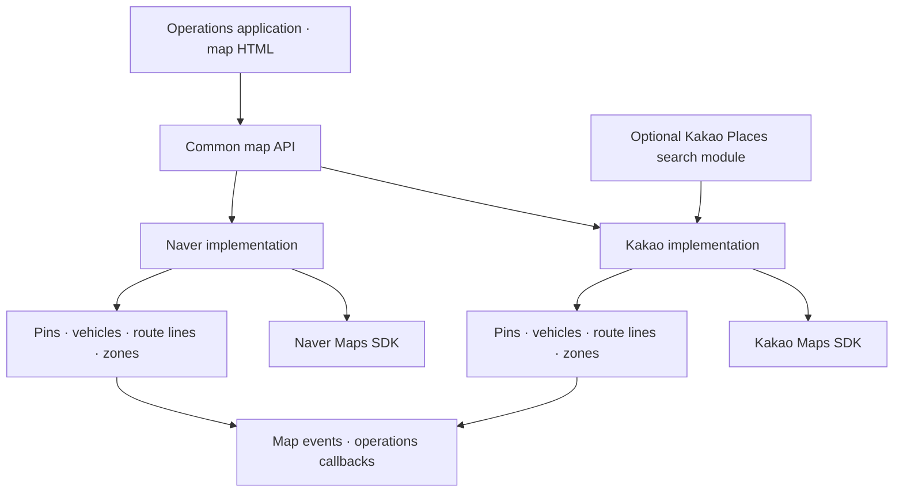

# 회사 공통 표준 맵 제작 — 영문 카드와 상세 원고

기준일: **2026-11-17 KST**. 최신 [한국어 승인 원고](STANDARD_MAP_PORTFOLIO_DRAFT.md)의 공개 본문과 캡션을 기준으로 번역했습니다. 사용자 승인 후 A의 영문 카드 3필드와 B의 별도 영문 상세를 Notion에 반영했으며 이 파일은 저장 결과의 대조 원고입니다. C는 Notion 본문에서 제외한 편집자 참고입니다. **한영 상세는 비공개이며 읽기 공개·DetailUrlEn 연결·배포는 수행하지 않았습니다.** 이미지 참조는 번호와 캡션만 표시하고 업무 원본·임시 이미지 URL은 복사하지 않습니다. 실제 확인 범위는 [현재 상태](../CURRENT_STATE.md#표준-맵-영문-카드와-상세-반영)를 따릅니다.

## A. 영문 카드

**NameEn**

Company-Wide Standard Map Modules

**DescriptionEn**

Kakao and Naver map modules expose a common API for pins, vehicles, route lines, and zones in the company's operations software, with subsequent refactoring and maintenance. In a two-person team, I co-developed the Kakao module, implemented the Naver module, and addressed errors and differences in host integration.

**RoleEn**

KakaoMap co-development, NaverMap implementation, and follow-up fixes and integration improvements based on the inherited eKsysMap standard.

**DetailUrlEn**

공란 유지. 영문 상세 작성과 인증된 본문 검증은 완료했지만 현재 비공개입니다. 읽기 공개·비로그인 확인 전에는 영문 주소를 카드에 연결하지 않으며 현재 카드의 상세 버튼은 한국어 원본으로 연결합니다.

기존 한국어 필드·태그·링크는 유지합니다. `WorkPeriod`는 최초 개발 **2024-10-14–2025-01-10** 한 구간이며, 리뉴얼·리팩토링 **2025-05-12–2025-06-16**은 아래 상세에 별도 표시합니다.

## B. 공개용 영문 본문 후보

> **Connecting common operations calls to Kakao and Naver map rendering and events.**

### 01. Overview

This project provides map modules for the company's operations software. A common API handles pins, vehicles, route lines, and zones, while rendering and event handling are connected to each map provider's SDK.

I worked with the company CEO in a two-person team. Building on the inherited eKsysMap standard, I co-developed KakaoMap and implemented NaverMap. Follow-up work addressed errors and differences in how the modules interacted with the operations host application.

| Item | Scope |
| --- | --- |
| Initial development | 14 October 2024–10 January 2025 |
| Renewal and refactoring | 12 May 2025–16 June 2025 |
| Development team | The company CEO and me — 2 people |
| My responsibility | Taking over the eKsysMap-based standard, co-developing KakaoMap, implementing NaverMap, and addressing errors and differences in operations-host integration |
| Core technologies | JavaScript, Kakao Maps, Naver Maps, HTML, CSS |

The technical cases below include **follow-up maintenance after these two participation periods**. The map screenshots are **local reproductions captured on 16 November 2026**, separate from production screens at the time of initial development or refactoring.

**Image 06**

*A local reproduction of the existing Kakao debug screen, showing zone creation and its title and detailed hint. Captured on 16 November 2026; the reference time in the information window is sample data.*

### 02. Problem and Constraints

The operations map needed to display vehicle headings and identifying captions, route lines, operational zones, and detailed information alongside locations. Even with the same common function calls, each map provider required its own handling of object creation and event registration and removal.

New features had to preserve the existing common calls and integration with the operations application. Search needed to be available on the screens that required it, and cleanup had to cover related information windows, result lists, and event state as well as visible markers.

### 03. My Role and System Context

My responsibility was to understand the inherited standard and connect provider-specific map implementations to the needs of the operations application.

| Area | My contribution |
| --- | --- |
| Existing standard | Understanding and using the inherited eKsysMap common-call structure |
| KakaoMap | Joint development with the CEO, followed by improvements to vehicle display, search, events, and zone hints |
| NaverMap | Implementation following the same standard, with fixes and additional work for differences in operations-host behavior |
| Feature handoff | Preparing feature documentation for the C++ developer and organizing the call and input contracts demonstrated by test HTML pages |

The common standard was an existing asset, and the map SDKs are external services. My scope did not include developing the map engines or the entire C++ operations application.

The diagram describes code layers rather than a server deployment topology.

JavaScript connects the common calls to provider-specific objects. HTML and CSS support map entry screens, vehicle display, and hint UI. Supported features and event contracts were considered separately for each provider.

**Image 02**

*The same sample data connected to the Naver map module. This local reproduction, captured on 16 November 2026, uses a capture-only auxiliary UI and does not establish support for the same search or polygon-hover behavior as Kakao.*

### 04. Implementation and Technical Decisions

#### Case 1. Rotating the vehicle image while keeping its identifying caption readable

Vehicle position, heading, and identifying information needed to remain readable together. Under the constraint of minimizing changes to the existing common calls, vehicles were represented with DOM-based CustomOverlay objects, with separate image and caption elements.

Only the image rotates with the heading; the caption stays upright. After the image loads, its actual dimensions are used to adjust the overlay's anchor point. Position, heading, and caption updates are connected to that object.

This case combines joint development and subsequent improvements. The structure is visible in the code supplied during follow-up work and in the current implementation. The handoff materials also record a local demonstration of heading changes and caption display. That demonstration does not establish large-fleet rendering performance or real-vehicle driving behavior.

**Image 03**

*A demonstration in which only the vehicle image rotates with the heading, while its identifying caption is displayed separately. A local reproduction captured on 16 November 2026 using a capture-only auxiliary UI and sample data.*

#### Case 2. Adding optional search and cleaning up markers, information windows, and result lists together

The existing map HTML needed keyword search for places and addresses. Search UI and state were kept in a separate module, enabled on the screens that needed it, to avoid duplicating the map core.

Kakao Places results were connected to a list and map markers. Selecting a list item displayed the corresponding location and information window. After the basic search was applied, problems were reported in which an information window remained after its marker was removed, and results remained after the search input was cleared.

The current implementation tracks the open information window through a single reference. Result cleanup connects **marker removal → information-window closure → list clearing**. Blank input uses the same reset path.

The evidence levels are separate: **the basic search had a recorded application confirmation; reset handling is confirmed in the current code. Execution after the reset changes and production rollout remain unverified.** This case does not claim to block late responses or resolve every asynchronous search scenario.

#### Case 3. Separating polygon-hint display from mouse-event handling

A flickering hint was reported when hovering over a polygon. The diagnosis considered whether a hint appearing beneath the cursor could cause repeated polygon leave and enter events. The visual hint was separated from mouse hit testing so that it would not intercept those events.

The CustomOverlay hint uses `pointer-events: none`. Polygon enter, move, and leave events update its visibility and position, with frequent position updates grouped through `requestAnimationFrame`.

Follow-up local verification records cover title and multiline-hint display, cursor following, hiding on exit, and zone deletion. When the same data was applied to the production baseline and development version, **successful zone creation and hover support were assessed separately**. A version that ignored the extra arguments and created only the zone was not counted as a successful hover implementation. These findings apply to the local conditions that were checked.

#### Additional work: provider-specific event contracts

A report that a Naver pin call worked on the web but failed inside the operations host led to tracing the common calls and event paths. Event removal also needed consideration when click behavior was disabled or an empty hint was supplied.

The inspected Naver ordinary-marker implementation stores listener handles returned during registration and uses them for removal. Kakao markers use the SDK's public event API. These observations are not extended to vehicle overlays or every other version.

### 05. Outcomes and Verification

Through joint development and follow-up work, I addressed vehicle display, search-result state, and provider-specific events while preserving the existing standard and operations integration. A key part of this work was **distinguishing visible map objects from the cleanup of their related information windows, lists, and events**.

The handoff materials' 2026 local verification records cover Kakao zone-hint display, cursor following, hiding on exit, and deletion. The capture records from 16 November 2026 cover maps, pins, route lines, and zones in the existing Kakao and Naver debug tools, together with Kakao zone-hint display. These records do not establish rollout across all options, browsers, or operational centers.

In 2026, I worked with AI tools to improve the local execution and comparison workspace. This was **follow-up environment maintenance separate from map development and refactoring in 2024–2025**. It is not presented as work or technology used during the earlier participation periods.

### 06. References

The project introduction image is a conceptual illustration of the common map API and the Kakao and Naver implementations. **It is not an actual UI or service screenshot.**

The four screenshots show the existing Kakao debug tool, a Naver map-module demonstration, vehicle headings and captions, and a route line drawn from supplied coordinates. **All are local reproductions captured on 16 November 2026.** The Naver and vehicle demonstrations use a capture-only auxiliary UI and sample data. The route line connects supplied coordinates; it is not a directions API result or a real-vehicle driving record.

**Image 08**

*The existing Kakao debug screen displays supplied coordinates as a route line and fits the map bounds. A local reproduction captured on 16 November 2026; this is not a directions API result or a real-vehicle driving record.*

A public repository and demonstration video are not provided. The still images explain structure and display state; they do not replace execution checks of search reset or event transitions. The original Korean UI is retained.

Original Korean case study: **회사 공통 표준 맵 제작**.

## C. 편집자용 대조 — Notion 공개 본문에서 제외

| 항목 | 원문 근거와 유지 범위 |
| --- | --- |
| 원고 상태 | 사용자 승인 후 영문 카드 3필드와 별도 영문 상세를 반영하고 A/B와 저장 결과를 대조. 읽기 공개·DetailUrlEn 연결·배포는 미수행 |
| 기간 | 최초 개발 2024-10-14–2025-01-10과 리뉴얼·리팩토링 2025-05-12–2025-06-16을 분리. `WorkPeriod`는 최초 개발 한 구간만 유지 |
| 팀과 개인 범위 | CEO와 본인 2명. eKsysMap 표준 인계, Kakao 공동 개발, Naver 구현·후속 보완. 기존 표준·외부 SDK·관제 C++ 전체를 단독 개발했다고 표현하지 않음 |
| 후속 시기 | 기술 사례에는 두 참여 기간 이후의 유지보수가 포함됨. 2026년 AI 협업 환경 정비·로컬 검증·촬영을 2024~2025년의 개발 실적·기술로 소급하지 않음 |
| 차량 사례 | 이미지·캡션 분리와 이미지 회전, 로드 후 기준점 조정. 공동 개발·제공 코드·후속 보완의 경계를 유지하고 대량 성능·실차 주행 성과를 주장하지 않음 |
| 검색 사례 | 선택적 Kakao Places 모듈과 정보창·마커·목록 초기화. 기본 적용 확인과 현재 정리 코드 구현을 구분. 수정 후 실행·운영 반영과 늦은 응답 차단은 미확인 |
| polygon 사례 | 깜빡임 원인은 가능성 진단으로 번역. `pointer-events: none`·이벤트·RAF와 후속 로컬 검증을 설명하고 생성 성공과 hover 지원을 분리 |
| 공급자 이벤트 | Naver 일반 marker의 listener 핸들 관리와 Kakao 공개 이벤트 API에 한정. 차량 overlay·다른 버전·모든 환경까지 해결했다고 확대하지 않음 |
| 사진과 캡션 | **06→02→03→08**을 원문과 같은 위치·순서로 사용하고 캡션을 번역. 06 정보창의 기준시간은 예제값, 02·03은 촬영용 보조 UI. 모두 2026-11-16 촬영본이며 검색 성공 증거로 전용하지 않음 |
| 프로젝트 소개 이미지 | 한영 상세의 커버에 같은 구성 일러스트를 적용하고 원본 바이트/SHA를 대조. 사진 06→02→03→08을 영문 캡션과 함께 보존하고 실제 UI·운영 증거와 구분 |
| 공개·링크 경계 | 한영 상세의 현재 비공개 상태와 API 읽기 권한을 구분. `DetailUrlEn`은 비워 두고 기존 한국어 상세로 fallback. 영문 상세 하단에 한국어 원문의 native 링크를 반영했으며 원고에는 제목으로 표시 |

공개 후보는 A의 필드 문구와 B의 본문입니다. C는 공개 본문에 포함하지 않습니다. 이 파일에는 이미지 바이트·임시 서명 URL·관리 ID·원문 대화·업무 소스·내부 경로를 넣지 않았습니다. 실제 반영·공개·로컬 검증 여부는 별도 작업의 승인과 [현재 상태](../CURRENT_STATE.md)를 기준으로 구분합니다.
