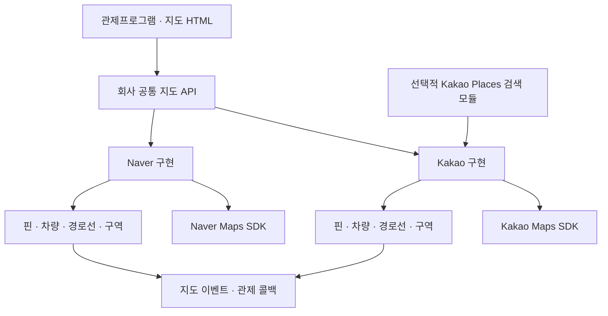

# 회사 공통 표준 맵 제작 — 포트폴리오 보완 초안

작성일: **2026-11-17 KST**. 1·2차 전달 자료를 함께 검토하고, 2차의 정정과 확인 수준을 우선한 승인 원고입니다. 확정된 프로젝트명·두 참여 기간·2인 팀·담당 범위를 유지합니다. 사용자 승인 후 현재 관리본 Notion DB에 반영했으며, 아래 본문과 캡션은 저장 결과의 대조 기준입니다. 실제 반영·접근 범위·로컬 검증은 [현재 상태](../CURRENT_STATE.md#표준-맵의-개인-db-반영과-로컬-검증)에 기록합니다.

## 1. 카드와 Notion 속성 제안

| 항목 | 제안 값 |
| --- | --- |
| `Name` | **회사 공통 표준 맵 제작** |
| `Description` | 회사 관제의 핀·차량·경로·구역을 공통 API로 다루는 Kakao·Naver 지도 모듈을 개발하고, 이후 리뉴얼·유지보수를 이어갔습니다. 제가 2인 팀에서 KakaoMap 공동 개발과 NaverMap 구현, 오류·관제 연동 차이에 따른 보완을 담당했습니다. |
| `Tags` | JavaScript · Kakao Maps · Naver Maps · HTML · CSS |
| `WorkPeriod` | **2024-10-14~2025-01-10 — 최초 개발** |
| 별도 참여 구간 | **리뉴얼·리팩토링 2025-05-12~2025-06-16** — 상세에 별도 표기 |
| `GitHub` · `Youtube` · 서비스 링크 | 비움 — 공개 가능한 주소 미제공 |
| 프로젝트 소개 이미지 | `public/images/project-covers/standard-map-concept-20261117.png` — 공통 API와 Kakao·Naver 구현, 차량·경로·구역을 설명하는 구성 일러스트 |

한 프로젝트로 소개합니다. 현재 날짜 속성은 한 구간이므로 두 참여 기간을 이어 붙이지 않습니다. 카드 설명에도 리뉴얼·유지보수가 별도 단계임을 드러내고, 상세 첫 표에서 두 기간을 함께 보여줍니다. Node.js와 2026년 작업환경 정비는 이 카드의 개발 기술·참여 기간에 포함하지 않습니다.

## 2. 공개 본문 후보

### 01. 프로젝트 개요

**관제의 공통 호출을 Kakao·Naver 지도 표현과 이벤트에 연결한 지도 모듈 개발 프로젝트입니다.**

회사 관제프로그램에서 핀·차량·경로·구역을 공통 API로 다루고, 실제 표시와 이벤트 처리는 각 지도 SDK에 맞게 연결했습니다. 대표님과 2명이 함께 작업하며 인계받은 eKsysMap 표준을 바탕으로 KakaoMap을 공동 개발하고 NaverMap을 구현했습니다. 이후 오류 수정과 관제 연동 차이에 따른 추가 개발을 이어갔습니다.

| 항목 | 내용 |
| --- | --- |
| 최초 개발 | **2024-10-14~2025-01-10** |
| 리뉴얼·리팩토링 | **2025-05-12~2025-06-16** |
| 개발 인원 | 대표님 · 본인, **2명** |
| 내 역할 | eKsysMap 기반 표준 인계, KakaoMap 공동 개발, NaverMap 구현 및 오류·관제 연동 차이에 따른 추가 개발 |
| 핵심 기술 | JavaScript · Kakao Maps · Naver Maps · HTML · CSS |

아래 기술 사례는 두 참여 구간 이후의 **후속 유지보수까지 포함**합니다. 본문의 지도 이미지는 **2026-11-16 로컬 재현 화면**으로, 최초 개발·리뉴얼 당시의 운영 화면과 구분합니다.

### 02. 해결할 문제

관제 지도에서는 위치뿐 아니라 차량의 방향과 식별 캡션, 경로선, 업무 구역과 상세 정보를 함께 보여줘야 했습니다. 같은 공통 함수를 호출해도 지도 공급자에 따라 객체 생성과 이벤트 등록·해제 방식이 달라 별도의 대응이 필요했습니다.

기존 공통 호출과 관제프로그램의 연결 구조를 유지하면서 기능을 추가하는 것이 제약이었습니다. 검색 기능은 필요한 화면에 붙일 수 있게 확장하고, 화면의 마커뿐 아니라 정보창·목록·이벤트처럼 함께 생기는 상태도 정리해야 했습니다.

### 03. 내 역할과 시스템 구성

제가 맡은 일은 기존 표준을 파악하고, 지도별 구현을 관제 요구와 연결하는 것이었습니다.

| 영역 | 담당 범위 |
| --- | --- |
| 기반 표준 | 인계받은 eKsysMap의 공통 호출 구조 파악·활용 |
| KakaoMap | 대표님과 공동 개발, 후속 차량 표현·검색·이벤트·구역 힌트 보완 |
| NaverMap | 기존 표준과 같은 구조에 맞춘 구현, 오류·관제 호스트 동작 차이에 따른 추가 개발 |
| 기능 전달 | C++ 담당자에게 지도 기능을 전달하기 위한 기능서, 테스트 HTML의 호출·입력 계약 정리 |

공통 표준과 지도 SDK는 기존 자산과 외부 서비스입니다. 지도 엔진이나 관제 C++ 프로그램 전체의 개발을 담당한 것은 아닙니다.

다음은 코드 계층을 설명하는 구성도입니다.

JavaScript로 공통 호출과 공급자별 객체를 연결하고, HTML·CSS로 지도 진입 화면과 차량·힌트 UI를 구성했습니다. 공급자별 지원 범위와 이벤트 계약은 따로 확인했습니다.

### 04. 주요 구현과 기술 선택

#### 사례 1. 차량 이미지는 방향에 맞춰 회전하고, 식별 캡션은 읽기 쉽게 유지

차량의 위치·방향·식별정보를 지도에서 함께 읽을 수 있어야 했습니다. 기존 공통 호출의 변경을 줄이는 조건에서 차량을 DOM 기반 CustomOverlay로 표현하고, 이미지와 캡션을 별도 요소로 다뤘습니다.

이미지에만 방향각을 적용하고 캡션은 회전시키지 않았습니다. 이미지가 로드된 뒤 실제 크기를 반영해 기준점을 조정하고, 위치·각도·캡션 갱신을 해당 객체에 연결했습니다.

공동 개발과 후속 보완으로 이어진 사례입니다. 후속 제공 코드와 현재 구현에서 이 구조가 확인되며, 전달 자료의 로컬 시연 기록에서도 방향 변경과 캡션 표시를 확인했습니다. 이 화면을 대량 차량 성능이나 실차 주행 검증으로 확대하지 않습니다.

#### 사례 2. 검색을 선택적으로 붙이고, 결과 마커·정보창·목록을 함께 정리

기존 지도 HTML에 장소·주소 키워드 검색을 추가해야 했습니다. 지도 코어와 중복되는 구현을 늘리지 않도록 검색 UI와 상태를 별도 모듈에 두고 필요한 화면에서 활성화하는 방식으로 구성했습니다.

Kakao Places 검색 결과를 목록과 지도 마커에 연결하고, 목록 선택 시 해당 위치와 정보창을 보여줬습니다. 기본 검색을 적용한 뒤에는 마커를 지워도 정보창이 남고, 검색어를 비워도 결과가 남는 문제가 확인됐습니다.

현재 구현은 열린 정보창을 하나의 참조로 추적합니다. 결과 정리 시 **마커 제거 → 정보창 닫기 → 목록 비우기**를 연결하고, 입력이 공백이 되면 같은 초기화 경로를 호출합니다.

확인 수준은 나눠 봅니다. **기본 검색은 당시 적용 확인이 있고, 초기화는 현재 코드에서 구현을 확인했습니다. 초기화 수정 뒤의 실행 재검증과 운영 반영은 미확인입니다.** 늦게 도착한 응답 차단이나 모든 비동기 검색 상황을 해결했다는 주장도 포함하지 않습니다.

#### 사례 3. polygon 힌트의 시각적 표시와 마우스 이벤트 판정을 분리

polygon에 마우스를 올렸을 때 힌트가 깜빡이는 문제가 보고됐습니다. 커서 아래 생긴 힌트가 polygon의 이탈·재진입을 유발할 수 있다는 진단을 바탕으로, 시각적인 힌트가 마우스 판정을 가로막지 않도록 분리했습니다.

CustomOverlay 기반 힌트에 `pointer-events: none`을 적용하고, polygon 진입·이동·이탈에 따라 표시·위치·숨김을 갱신했습니다. 잦은 위치 갱신은 `requestAnimationFrame`으로 묶었습니다.

후속 로컬 검증 기록에서는 제목과 여러 줄 힌트, 커서 추종, 이탈 시 숨김과 구역 삭제를 확인했습니다. 운영 기준본과 개발본에 같은 데이터를 넣어 비교할 때는 **구역 생성 성공과 hover 지원을 별도로 판정**했습니다. 추가 인자를 무시하고 구역만 생성하는 경우를 hover 성공으로 판단하지 않았습니다. 이 결과는 해당 로컬 조건의 확인 범위입니다.

#### 공급자별 이벤트 계약 보완

웹에서 동작하던 Naver 핀 호출이 관제 호스트에서는 실패한다는 보고를 바탕으로 호출과 이벤트 경로를 추적했습니다. 클릭 옵션을 끄거나 빈 힌트를 전달할 때도 이벤트 해제 경로를 확인해야 했습니다.

확인한 Naver 일반 marker 구현은 등록 시 반환된 listener 핸들을 저장해 해제하고, Kakao marker는 SDK의 공개 이벤트 API를 사용합니다. 차량 overlay나 다른 버전까지 동일하게 해결했다고 확대하지 않습니다.

### 05. 결과와 검증

기존 표준과 관제 연결을 유지하면서 차량 표현, 검색 결과 상태와 공급자별 이벤트 차이를 다뤘습니다. 특히 **지도 객체가 보이는 것과 연결된 정보창·목록·이벤트가 올바르게 정리되는 것을 나눠 분석**한 경험입니다.

전달 자료의 2026년 후속 로컬 검증 기록에서는 Kakao 구역 힌트의 표시·추종·이탈·삭제를 확인했습니다. 2026-11-16 촬영 기록에서는 기존 Kakao·Naver debug의 지도·핀·경로선·구역과 Kakao의 구역 힌트 표시를 확인했습니다. 이 자료만으로 모든 옵션·브라우저·센터의 운영 반영을 입증하지는 않습니다.

2026년에는 AI와 협업해 로컬 실행·비교 작업환경을 정비했습니다. 이 작업은 **2024~2025년 지도 개발·리팩토링과 별개의 후속 정비**입니다. 과거 참여 기간의 성과나 당시 사용 기술로 소급하지 않습니다.

### 06. 관련 자료

프로젝트 소개 이미지는 공통 지도 API와 Kakao·Naver 구현을 설명하는 구성 일러스트이며 실제 서비스 화면·동작 증거가 아닙니다.

기존 Kakao debug, Naver 지도 모듈 시연, 차량 방향·캡션, 입력 좌표의 경로선 화면을 제공합니다. **모두 2026-11-16 로컬 재현 화면**이며, Naver 모듈·차량 시연은 촬영용 보조 UI와 예시 데이터를 사용했습니다. 경로선은 전달한 좌표를 연결한 것으로 길찾기 API 결과나 실차 주행 기록을 뜻하지 않습니다.

공개 저장소와 시연 영상은 제공하지 않습니다. 정지 화면은 구성과 표시 상태를 설명하며, 검색 초기화나 이벤트 전환의 실행 검증을 대신하지 않습니다.

## 3. 이미지 배치와 공개 캡션 제안

아래 파일명은 전달된 본문 이미지의 식별명입니다. 사용자 승인 후 선별한 4장을 Notion 본문에 업로드했습니다. 후속 요청으로 별도 AI 구성 일러스트를 프로젝트 소개 이미지로 제작해 페이지 커버에 적용했으며, 본문 사진 4장은 유지했습니다. 이 문서에는 원본 업무 자료나 사진 사본을 추가하지 않았습니다. 전달된 사진 9장은 모두 1차와 동일한 2026-11-16 촬영본입니다.

| 순서·위치 | 이미지 | 공개 캡션 |
| --- | --- | --- |
| 개요 뒤 | `06-kakao-original-debug.jpg` | 기존 Kakao debug에서 구역을 생성하고 제목과 상세 힌트를 확인한 로컬 재현 화면입니다. 2026-11-16 촬영이며 정보창의 기준시간은 예제값입니다. |
| 역할·구성 뒤 | `02-naver-overview.jpg` | 같은 예시 데이터를 Naver 지도 모듈에 연결한 화면입니다. 촬영용 보조 UI를 사용한 2026-11-16 로컬 재현이며, Kakao와 같은 검색·polygon hover 지원을 뜻하지 않습니다. |
| 차량 사례 뒤 | `03-vehicle-overlay.jpg` | 차량 이미지만 방향에 맞춰 회전하고 식별 캡션은 별도로 표시한 시연입니다. 촬영용 보조 UI·예시 데이터를 사용한 2026-11-16 로컬 재현 화면입니다. |
| 관련 자료 | `08-kakao-original-route.jpg` | 기존 Kakao debug에서 입력 좌표를 경로선으로 표시하고 지도 범위를 맞춘 화면입니다. 2026-11-16 로컬 재현이며, 길찾기 API 결과나 실차 주행 기록이 아닙니다. |

검색 사례는 본문으로 설명합니다. 검색창이 보이는 이미지를 검색 결과·초기화 성공 증거로 대신 사용하지 않습니다. polygon 사례는 앞서 배치한 06 화면을 함께 참고하도록 하고 같은 사진을 반복 배치하지 않습니다.

01 전체 시연은 다른 화면과 설명이 겹쳐 기본 배치에서 제외합니다. 04 힌트 정지 화면은 추종·깜빡임 해소를 단독 입증하지 못해 보조 후보로 남깁니다. 05 작업공간은 2026년 정비를 별도 소개할 때만 사용합니다.

07·09 Naver debug는 로고·축척은 보이지만 좌하단 출처 문구의 표시를 이번 육안 검수에서 확인하지 못했습니다. 기본 배치에는 출처 문구까지 보이는 02를 사용하고, 07·09는 출처 표시가 가려지지 않은 원본을 확인한 뒤 다시 검토합니다. 기존 파일은 편집하지 않습니다.

카드에서는 별도 구성 일러스트를 `contain`으로 전체 표시하고, Notion 헤더에서도 ‘구성 일러스트 · 실제 화면 아님’ 안내가 보이도록 위치를 조정했습니다. 본문은 실제 촬영 원본 전체와 위 캡션을 유지합니다. 실제 확인한 화면·크기·접근 조건은 현재 상태에 구분해 기록합니다.
